<div align="center">


### 🛡️ TR3000 专用 · 一个窗口管好你的网络出口、无线热点与分流账单

**✨ 五源门禁防裸连 · 30 秒防锁死无线桥接 · 极简双频 Wi‑Fi 管理 · 跨重启分流流量统计 ✨**

<br />

[](https://github.com/2014-y/Guardline-Status/releases/latest)
[](#-系统要求)
[](#3-苹果-mac-电脑安装与首次打开说明)
[](#-系统要求)
[](#-隐私与安全)
[](LICENSE)

<br />

[🚀 快速开始](#-快速开始) •
[✨ 核心功能](#-核心功能) •
[🖼️ 界面一览](#️-界面一览) •
[📖 功能详解](#-功能详解) •
[⚙️ 工作原理](#️-工作原理) •
[🔒 隐私与安全](#-隐私与安全) •
[❓ 常见问题](#-常见问题)

<br />

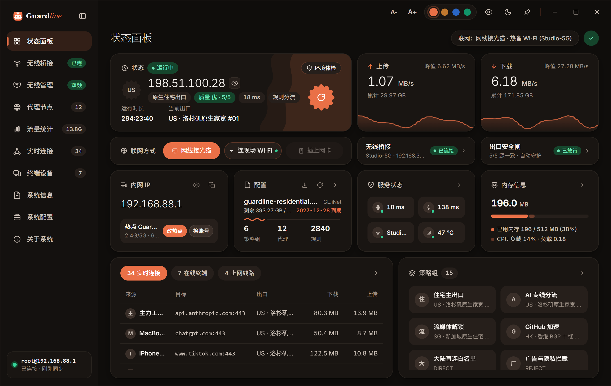

<sub>📸 截图使用的是虚构的演示设备、RFC 5737 测试网段 IP 与模拟流量数据</sub>

</div>

<br />

> [!IMPORTANT]
> **TR3000 专用本地直连控制台**：Guardline Status 运行在你的 Windows 或 Mac 电脑本地，仅通过局域网加密通道连接**你自己的 TR3000 设备**，无需任何云端中转服务器，不收集、不上传任何账号密码或网络记录。

---

## 💡 为什么需要它

日常居家办公或随身携带 **TR3000** 出差组网时，如果只靠传统浏览器网页后台管理，往往会遇到这些麻烦：

| 😫 传统网页后台管理 | 😎 有了 Guardline Status |
|---|---|
| 去酒店或换办公室连上级 Wi‑Fi 要进多层后台菜单，**输错一位密码直接导致设备失联锁死** | 点一下「**扫描附近热点**」输入密码，**30 秒未获 IP 自动回滚恢复原配置**，绝不锁死后台 |
| 上级断网重拨或节点波动瞬间，本地真实宽带 IP **裸连暴露**却浑然不知 | **五源出口安全门禁**毫秒级关闸阻断，经 5 路独立探针一致确认住宅 IP 后自动放行 |
| 看网速、切节点、改 Wi‑Fi、查连接分散在不同后台页面，**好几个标签页来回切** | **一个无边框原生桌面窗口**聚合出口状态、平滑波形、无线管理、节点测速与实时连接 |
| 设备一断电重启，页面里的**代理流量和直连流量全部清零**，没法核对月度账单 | 内核 `nftables` 旁路采集 + 本机 SQLite 持久库，**跨重启不丢数据**，6 级粒度随时导出 CSV |
| 想改 TR3000 的双频 Wi‑Fi 密码、给内网设备标名字、或者**发截图给别人怕暴露公网 IP** | 极简双频合一开关、内网设备自定义中文备注与一键禁网、右上角 **小眼睛一键全局脱敏** |

---

## ✨ 核心功能

<table width="100%">
<tr>
<td width="33%" valign="top">
<h3>🛡️ 五源出口安全门禁</h3>
<p>链路切换或代理重载瞬间自动关闸阻断转发；后台通过 5 路独立公网探针一致确认为预期住宅 IP 后自动放行，支持更换住宅节点时一键安全对齐新出口。</p>
</td>
<td width="33%" valign="top">
<h3>📡 30 秒防锁死无线桥接</h3>
<p>一键扫描周边 2.4G / 5G Wi‑Fi 与隐藏热点，切换前自动备份无线快照；密码有误或 30 秒未获 IP 自动还原，支持常用热点加密记忆库与通电自动回连。</p>
</td>
<td width="33%" valign="top">
<h3>📶 极简双频 Wi‑Fi 管理</h3>
<p>独立控制 TR3000 自身发射的 2.4G（穿墙）与 5G（高速）频段，关闭任一频段均不影响上级无线桥接；支持一键开启「双频合一」、改密与复制密码。</p>
</td>
</tr>
<tr>
<td width="33%" valign="top">
<h3>🌐 代理节点与封条订阅</h3>
<p>支持策略组拖拽快切、并发延迟测速、可用节点过滤与右侧节点详情抽屉；支持在线订阅链接或粘贴 YAML 安全同步节点与中继白名单。</p>
</td>
<td width="33%" valign="top">
<h3>📊 跨重启分流流量账单</h3>
<p>内核层精准剥离「代理流量 / 直连流量 / 总流量」并持久化落盘，支持 5 分钟、小时、天、月、季、年 6 级粒度与自选时段查询，一键导出桌面 CSV 报表。</p>
</td>
<td width="33%" valign="top">
<h3>🔍 实时连接与规则追踪</h3>
<p>秒级透视内网每台设备的活跃连接、目标域名/端口、命中规则（Rule &amp; Payload）与最终出口节点；支持按终端或节点筛选，以及「暂停刷新」定格排查。</p>
</td>
</tr>
<tr>
<td width="33%" valign="top">
<h3>💻 局域网终端管控</h3>
<p>融合 DHCP、ARP、无线射频与连接表识别设备状态，查看 2.4G/5G 信号强度与单机实时网速；支持绑定<b>自定义中文备注名</b>及单设备一键禁网/恢复（含本机防误锁保护）。</p>
</td>
<td width="33%" valign="top">
<h3>🩺 出口纯净度全景体检</h3>
<p>一键实测当前公网出口的住宅 ISP 原生属性、IPv6 / WebRTC / DNS 防泄露状态，以及 Claude、ChatGPT、Google、TikTok、GitHub 实时连通延迟，一键复制报告。</p>
</td>
<td width="33%" valign="top">
<h3>🙈 隐私小眼睛 &amp; 托盘常驻</h3>
<p>右上角一键开启全局隐私脱敏，自动打码全界面公网/内网 IP、MAC 与订阅链接；支持多台 TR3000 秒切、主题换肤、开机静默自启与点击托盘 0 秒唤出。</p>
</td>
</tr>
</table>

---

## 🖼️ 界面一览

<table>
<tr>
<td width="50%">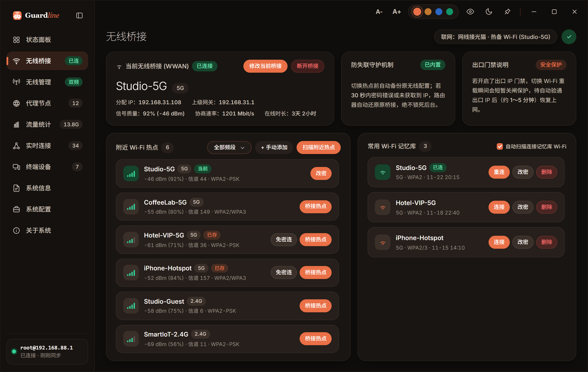<p align="center"><b>📡 无线桥接</b> · 扫描周边 2.4G/5G 热点，30 秒防失联回滚与常用热点记忆库</p></td>
<td width="50%">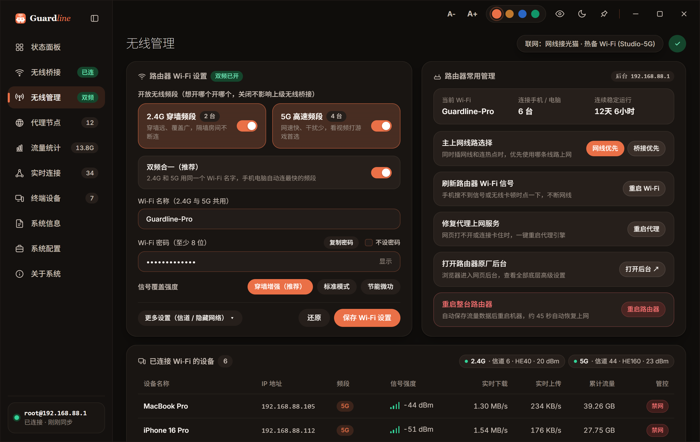<p align="center"><b>📶 无线管理</b> · 2.4G / 5G 频段独立大开关、双频合一与一键改密</p></td>
</tr>
<tr>
<td width="50%">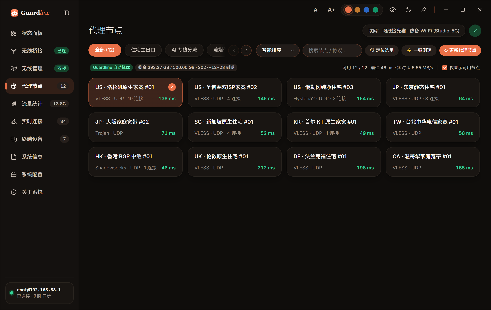<p align="center"><b>🌐 代理节点</b> · 策略组快切、并发延迟测速与封条级订阅同步</p></td>
<td width="50%">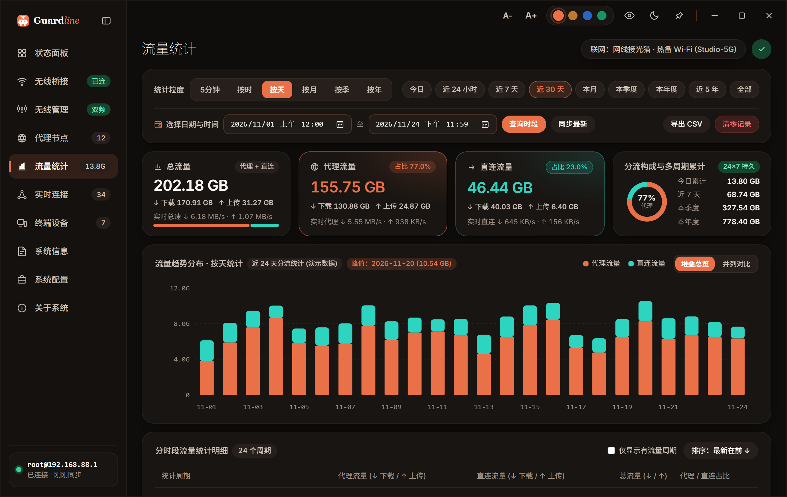<p align="center"><b>📊 流量统计</b> · 代理 / 直连分流构成、6 级时间粒度与 CSV 账单导出</p></td>
</tr>
<tr>
<td width="50%">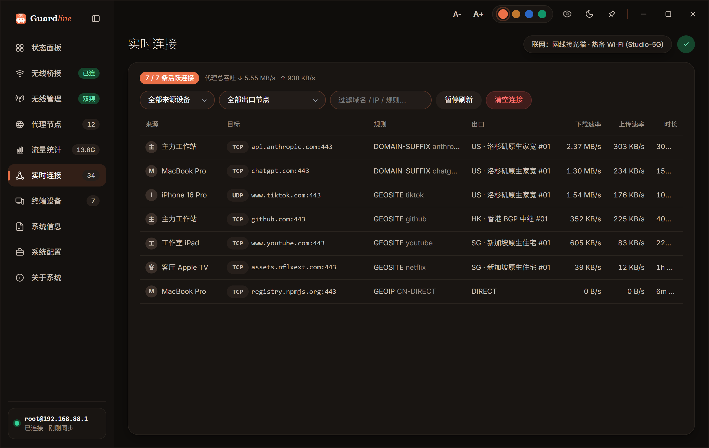<p align="center"><b>🔍 实时连接</b> · 按来源设备与出口节点筛选，秒级追踪命中分流规则</p></td>
<td width="50%">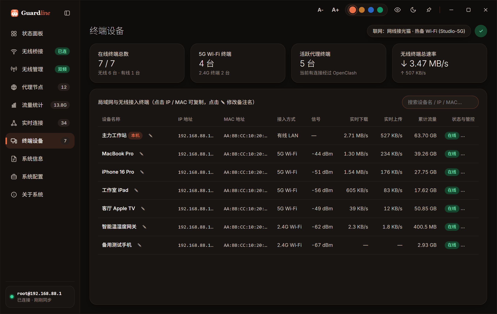<p align="center"><b>💻 终端设备</b> · 信号强度、单机网速、自定义中文备注与一键禁网</p></td>
</tr>
<tr>
<td width="50%">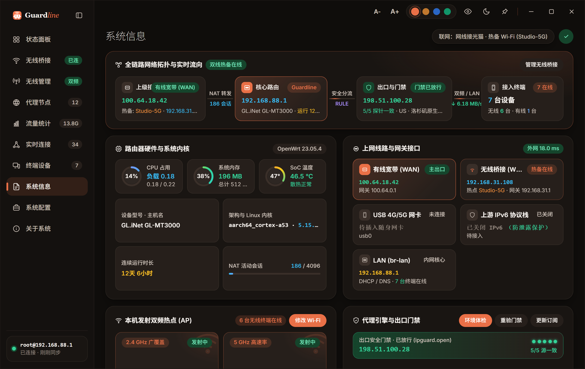<p align="center"><b>🧭 系统信息</b> · 四段动态网络拓扑流向、硬件仪表与五源门禁探针</p></td>
<td width="50%">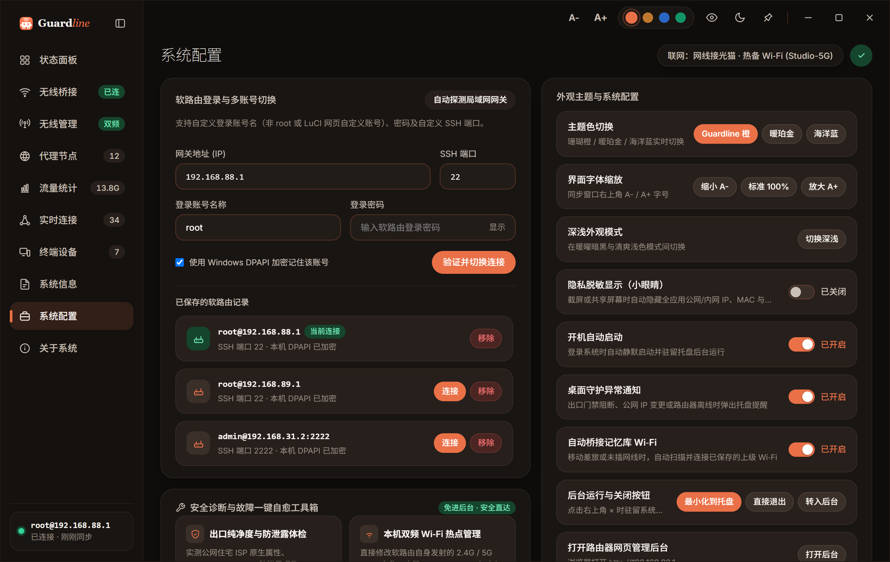<p align="center"><b>🛠️ 系统配置</b> · 安全体检、故障一键自愈工具箱、多设备切换与外观设置</p></td>
</tr>
<tr>
<td colspan="2">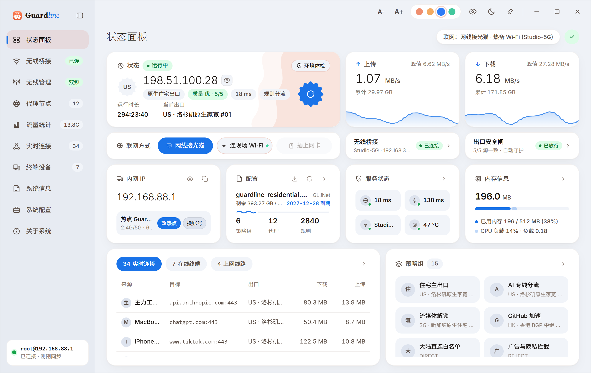<p align="center"><b>🌞 清爽浅色模式 + 海洋蓝主题色</b> · 支持多套主题色、深浅外观与 90%～124% 字号缩放</p></td>
</tr>
</table>

---

## 🚀 快速开始


> [!TIP]
> **只需要两样东西**：一台 Windows 10 / 11 或苹果 Mac 电脑，以及已接入同一局域网的 **TR3000 设备**。**完全不需要安装 Python、Node.js 或任何编程环境。**

### 1️⃣ 下载安装包

前往 [**Releases 最新版发布页**](https://github.com/2014-y/Guardline-Status/releases/latest) 按你的电脑系统下载：

| 安装包文件 | 适用系统 | 说明 |
|---|---|---|
| 🪟 **`Guardline-Status-v3.3.2-Setup.exe`** | **Windows 10 / 11 (x64)** | **Windows 用户推荐**（原 `Guardline Status-安装包.exe`）。单文件图形安装向导，支持桌面/开始菜单快捷方式、无损覆盖升级与标准卸载 |
| 🍎 **`Guardline-Status-macOS-v3.3.1.dmg`** | **macOS（苹果电脑）** | **Mac 用户推荐**（原 `Guardline Status-macOS-v3.3.1.dmg`）。双击打开后将应用拖入「应用程序」文件夹即可使用 |
| 📦 **`Guardline-Status-v3.3.2-Package-and-Source.zip`** | Windows / 开发者 | 完整发行归档包（原 `Guardline Status-v3.3.2-安装包与源码.zip`），内含 Windows 安装器、完整源码与离线文档 |

### 2️⃣ Windows 电脑安装与升级

1. 直接双击运行 **`Guardline-Status-v3.3.2-Setup.exe`**（默认安装至 `%LOCALAPPDATA%\Programs\RouterPanel`，**不需要管理员权限**，也可自由选择安装目录）。
2. 若本机正在运行旧版本，安装向导会自动平滑关闭旧进程并替换程序文件——**原本保存的加密账号密码、设备备注名与历史流量数据库完全保留**。
3. 若 Windows 10 精简版系统缺少微软 Edge WebView2 运行组件，程序会自动检测并引导在线补齐。

<details>
<summary>🛠️ Windows 命令行静默安装（批量部署与自动升级脚本）</summary>

```powershell
.\Guardline-Status-v3.3.2-Setup.exe --silent
```

静默模式无需人工点击，自动将最新版本部署至 `%LOCALAPPDATA%\Programs\RouterPanel` 并刷新桌面及开始菜单快捷方式。

</details>

### 3️⃣ 苹果 Mac 电脑安装与首次打开说明

1. 双击打开 **`Guardline-Status-macOS-v3.3.1.dmg`**，将窗口里的 **`Guardline Status`** 拖到旁边的 **「应用程序 (Applications)」** 文件夹。
2. **首次打开必看（解决「无法验证开发者 / 已损坏」提示）**：
   由于应用未附带苹果付费商业公证签名，**仅第一次启动时**需按你的 macOS 版本放行一次（之后直接双击即可打开）：
   - **macOS 14 (Sonoma) 及更早版本**：在「访达 → 应用程序」中 **右键（或按住 `Control` 点按）** `Guardline Status` → 点击 **「打开」** → 在弹窗中再点一次 **「打开」**。
   - **macOS 15 (Sequoia) 及更高版本**：先在「应用程序」中双击一次 `Guardline Status`（弹出拦截提示后点完成/取消），随后打开 **「系统设置 → 隐私与安全性」**，拉到页面最下方找到 **「已阻止打开 Guardline Status」**，点击 **「仍要打开」** 并输入开机密码确认。
   - **如果提示「“Guardline Status”已损坏，无法打开」**：打开 Mac 自带的 **「终端 (Terminal)」**，粘贴运行下面这行命令后再打开即可：
     ```bash
     xattr -dr com.apple.quarantine "/Applications/Guardline Status.app"
     ```

### 4️⃣ 连接 TR3000 并选择联网方式

1. **确认局域网连接**：先让电脑插上 **TR3000 的 LAN 口网线**，或连上 **TR3000 自身发射的 Wi‑Fi**（注意不要连在光猫等上级网络的 Wi‑Fi 下）。
2. **一键探测登录**：打开 Guardline Status，登录框会自动扫描局域网内的 TR3000 网关（如 `192.168.88.1`、`192.168.89.1`、`192.168.1.1` 等）。点击探测到的网关标签，输入账号（默认 `root`）与管理密码，点击 **「立即登录」**。
3. **三大联网场景随心用**：
   - 🏠 **居家 / 办公室固定宽带**：光猫网线插 TR3000 的 WAN 口即自动作为主出口；还可去「📡 无线桥接」连上现场备用 Wi‑Fi 或手机热点作为 **热备线路（Standby）**，有线断网自动无缝接管。
   - 🏨 **酒店差旅 / 临时办公**：不用找网线口，进入「📡 无线桥接」→ 点「扫描附近热点」→ 选现场 2.4G / 5G Wi‑Fi 输入密码连接，手机电脑连 TR3000 的 Wi‑Fi 即可全员共享纯净住宅出口。
   - 🚐 **户外移动 / 无宽带**：把 4G/5G 随身网卡插到 TR3000 侧面的 USB 口，或用数据线连手机开启「USB 网络共享」，即插即用识别为移动蜂窝主出口。

> [!NOTE]
> 无线桥接仅支持常规密码认证（WPA / WPA2 / WPA3）或开放网络，不支持需要浏览器弹窗输入手机号验证码的公共 Portal 认证热点。遇到酒店 Portal 热点时，建议先用手机连酒店 Wi‑Fi 完成认证，再开启手机热点给 TR3000 桥接。

---

## 📖 功能详解

### 🛡️ 1. 五源出口安全门禁（Kill-Switch）与住宅 IP 对齐

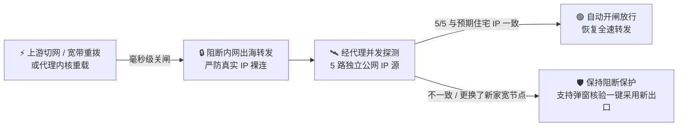

- **多重交叉验证**：同时向 `amazonaws`、`ifconfig.me`、`ipify`、`ipinfo`、`cloudflare` 5 个独立公网源探测当前代理出口，杜绝单一探针缓存误判。
- **更换住宅节点安全对齐**：当你更换了新的静态住宅订阅导致实测出口与门禁旧预期不一致时，面板会自动拦截裸连并展示新 IP 的归属地与 ISP 信息，确认无误后点击「采用新出口」即可安全写入门禁并放行。

### 📡 2. 无线桥接与 30 秒快照防锁死自愈

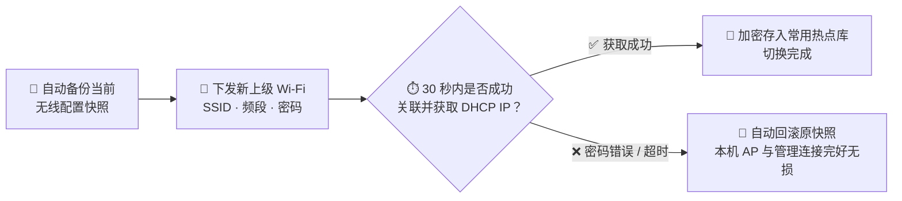

- **无损隔离**：无线桥接全程只操作 TR3000 的 `wwan` 上游客户端接口，**绝不触碰**代理配置、分流规则与防火墙封条。
- **常用 Wi‑Fi 记忆库**：连接成功过的办公室、家里、手机热点会自动加密记住密码；勾选「自动扫描连接记忆库 Wi‑Fi」后，携带 TR3000 换场地通电即可自动回连熟悉的热点。

### 📶 3. 极简双频 Wi‑Fi 热点管理

| 功能 | 说明 |
|---|---|
| **2.4G / 5G 独立大开关** | 2.4G 穿墙覆盖广、5G 高速干扰少，想开哪个开哪个；**即使关闭本机发射频段，也完全不影响上级无线桥接** |
| **双频合一（推荐）** | 开启后 2.4G 与 5G 共用同一个 Wi‑Fi 名称与密码，手机电脑根据距离自动无缝切换最佳频段；关闭后可分别设置独立名称 |
| **高级射频与快捷维护** | 支持一键复制密码、隐藏 SSID、调节发射功率档位（穿墙增强 / 标准 / 节能）及自定义 5G `HE80 / HE160` 满血高频宽信道 |

### 🌐 4. 代理节点测速与封条级订阅更新

- **策略组与并发测速**：支持鼠标拖拽或滚轮横滑切换策略组，支持按延迟/名称排序、「仅显示可用节点」过滤、一键定位当前选用节点，以及全组并发真实延迟测速（绿/黄/橙/红四色直观分级）。
- **节点会话抽屉**：点击任意节点卡片即可在右侧滑出详情抽屉，查看该节点当前承载的所有内网设备连接与单点重测延迟。
- **封条保护订阅向导**：点击「更新节点」可输入在线订阅链接或直接粘贴 YAML 配置；系统自动经封条校验同步大陆中继白名单（`mainland-nodes.list`）并平滑重载规则。

### 📊 5. 跨重启分流流量统计与 CSV 账单

- **内核旁路零损采集**：通过设备只读 `nftables` 计数器实时剥离 **代理流量**、**直连流量** 与 **总流量**，后台自动增量归档至本机 SQLite 数据库（`traffic.db`），设备断电或电脑重启均不会归零。
- **六级时间粒度**：支持 `5 分钟`、`按小时`、`按天`、`按月`、`按季度`、`按年度` 六档聚合，提供今日、近 24 小时、近 7/30 天、本季、本年及精确到分钟的自选区间查询。
- **双模式图表与报表导出**：分流占比环形图 +「堆叠总览 / 并列对比」交互柱状图，下方明细表支持过滤空周期并 **一键导出桌面 CSV 表格**。

### 🔍 6. 实时连接追踪与局域网终端管控

- **实时连接透视**：列出局域网内每一条活跃 TCP/UDP 会话的来源终端、目标域名/端口、命中的分流规则（如 `DOMAIN-SUFFIX` / `GEOSITE`）与最终出口节点；点击「暂停刷新」可定格当前画面逐条排查分流问题，也可一键清空旧连接促使客户端按新策略重连。
- **终端备注与防蹭网**：自动融合 DHCP 租约、ARP 表与无线射频状态，点击设备旁的 `✎` 即可绑定中文备注名（如 `主力工作站`、`工作室 iPad`），在状态面板与实时连接页同步显示；发现陌生设备可一键点击 **「禁网」** 阻断其出海（当前操作本机自动受防误锁保护）。

### 🩺 7. 出口纯净度全景体检与故障一键自愈

在「状态面板」顶部或「系统配置」中内置免进后台的诊断与自愈工具箱：

| 工具 | 作用 |
|---|---|
| **🩺 出口纯净度与防泄露体检** | 一键实测公网出口的住宅 ISP / ASN 属性、5 源探针一致性、IPv6 防泄露状态，以及 Claude、ChatGPT、Google、TikTok、GitHub 连通延迟，支持一键复制文字版报告 |
| **🔄 重验安全闸** | 网络切换后若网页暂未打通，点击立即触发五源门禁重新探测核验并开闸放行 |
| **⚡ 重启代理内核** | 平滑重启 TR3000 上的代理分流引擎，不影响无线连接 |
| **🔌 安全重启整台设备** | 先将内存中的实时分流流量数据安全刷盘保存，再重启 TR3000 系统（约 45 秒自动重连恢复） |

### 🎨 8. 个性化外观、隐私脱敏与系统托盘

| 设置项 | 功能说明 |
|---|---|
| 🙈 **全局隐私脱敏（小眼睛）** | 点击窗口右上角小眼睛按钮，全界面所有公网/内网 IP、MAC 地址、网关输入框与订阅链接自动打码遮蔽，复制的体检报告也同步脱敏，截屏/直播/远程协助零顾虑 |
| 🔀 **多台 TR3000 加密记忆** | 支持同时保存多台 TR3000 的网关 IP、自定义端口与加密凭据，在「系统配置」中一键秒切 |
| 🎨 **主题色与深浅模式** | 内置 Guardline 珊瑚橙、暖珀金、海洋蓝主题配色，支持暖曜暗黑 / 清爽浅色一键切换 |
| 🔍 **无级字号缩放与置顶** | 右上角 `A-` / `A+` 支持 `90% ～ 124%` 界面字号缩放，支持窗口置顶悬浮监控 |
| 🛎️ **托盘常驻与开机自启** | 点击 `×` 可最小化驻留系统托盘后台低耗保活，单击托盘图标 **0 秒无闪烁唤出**；支持开机自动静默驻留托盘启动，重复打开自动唤醒已有窗口 |

---

## ⚙️ 工作原理

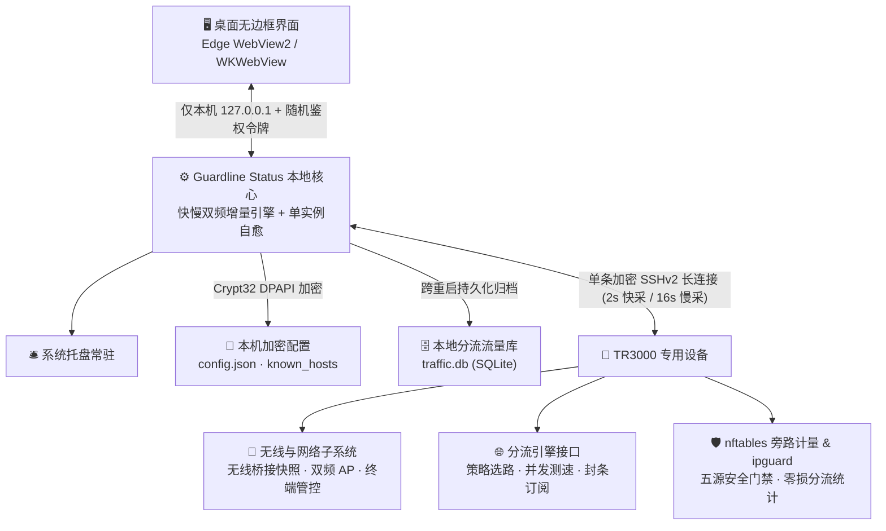

| 本机路径（Windows） | 存储内容 |
|---|---|
| `%LOCALAPPDATA%\Programs\RouterPanel\` | 桌面客户端默认安装目录（主程序 `RouterPanel.exe`） |
| `%APPDATA%\RouterPanel\config.json` | 界面偏好、终端中文备注及经 **Windows DPAPI 加密**的设备/热点凭据 |
| `%APPDATA%\RouterPanel\traffic.db` | 本地 SQLite 分流流量持久化数据库（5 分钟桶与日/月聚合账单） |
| `%APPDATA%\RouterPanel\known_hosts` | 设备 SSH 主机公钥指纹记录 |
| `%APPDATA%\RouterPanel\panel.log` | 无控制台窗口模式下的本地运行诊断日志 |

---

## 🔒 隐私与安全

- ✅ **100% 本地直连架构**：没有任何第三方云端后台，所有配置、终端备注与流量数据库均只保存在你自己的电脑本机。
- ✅ **系统级硬件绑定加密**：TR3000 登录密码与记忆库 Wi‑Fi 密码均使用 Windows `Crypt32 DPAPI` 绑定当前系统登录账户加密，配置文件绝无明文密码，拷贝到其他电脑亦无法解密。
- ✅ **本机接口鉴权隔离**：内置高速增量状态通道仅监听本机回环地址 `127.0.0.1`，且每次启动生成独立随机鉴权 Token，外部网络或其他程序无法调用。
- ✅ **单连接超低开销**：对 TR3000 仅维持单条复用加密长连接与只读 `nftables` 旁路采集，7×24 小时常驻运行对设备 CPU 几乎零负担，且绝不破坏防火墙封条规则。
- ✅ **一键截屏防泄露**：内置全局隐私脱敏模式，在展示或求助排查时一键遮蔽全部敏感网络地址。

---

## ❓ 常见问题

<details>
<summary><b>打开软件后扫描不到 TR3000，或者登录提示连接超时？</b></summary>

1. 请确认电脑当前连接的是 **TR3000 的 LAN 口网线** 或 **TR3000 自身发射的 Wi‑Fi**（如果电脑连在光猫或其他上级网络的 Wi‑Fi 上，因跨网段隔离是无法直接访问下级 TR3000 设备的）。
2. 如果修改过管理网段或自定义了 SSH 端口（非默认 `22`），直接在登录窗口手动填入网关 IP 与端口即可。
</details>

<details>
<summary><b>苹果 Mac 电脑打开提示「无法验证开发者」或「已损坏，无法打开」怎么办？</b></summary>

这是 macOS Gatekeeper 对未附带苹果商业公证签名应用的默认拦截，只需在首次安装后放行一次：
- **提示「已损坏」**：打开「终端 (Terminal)」，执行 `xattr -dr com.apple.quarantine "/Applications/Guardline Status.app"` 后即可正常打开。
- **提示「无法验证开发者」**：macOS 14 及更早在「应用程序」里右键图标点「打开」；macOS 15 及更高在双击拦截后前往「系统设置 → 隐私与安全性」底部点击「仍要打开」。
</details>

<details>
<summary><b>在「无线桥接」切换上级 Wi‑Fi 时不小心输错了密码，会把 TR3000 锁死失联吗？</b></summary>

**绝对不会。** 每次发起无线桥接或改密前，系统都会在设备端自动保存原无线配置快照。如果 30 秒内密码认证失败或没有拿到上级 DHCP 分配的 IP，TR3000 会自动回滚恢复原桥接状态与本机 Wi‑Fi 热点，你的电脑和手机不会失联。
</details>

<details>
<summary><b>刚切换完热点或刚重启设备时，为什么前十几秒打不开海外网页？</b></summary>

这是 **五源出口安全门禁（Kill-Switch）** 正在保护你，防止链路切换瞬间使用本地宽带真实 IP 裸连出海。通常等待数秒待后台 5 路探针确认住宅 IP 恢复一致后就会自动开闸放行；你也可以在「系统配置」页点一下 **「重验安全闸」** 立即触发放行。
</details>

<details>
<summary><b>更换了新的静态住宅代理订阅后，面板显示「出口与预期不符 · 已阻断」？</b></summary>

因为新住宅节点的出口 IP 与门禁里锁定的旧住宅 IP 不同，门禁自动拦下了流量以防异常跳 IP。此时状态面板会自动弹出安全复核提示（也可手动点门禁卡片上的采用按钮），核对新出口 IP 与归属地无误后点确定，即可自动更新门禁预期并立即放行。
</details>

<details>
<summary><b>安装新版本覆盖升级时，以前保存的密码、设备备注和历史流量会丢吗？</b></summary>

**不会丢失。** 升级安装只更新程序目录（`%LOCALAPPDATA%\Programs\RouterPanel`），而加密配置与 SQLite 流量数据库独立存放在 `%APPDATA%\RouterPanel` 下，覆盖升级后会自动无缝继承。
</details>

<details>
<summary><b>关闭 TR3000 的 2.4G 或 5G 发射开关，会影响正在使用的无线桥接吗？</b></summary>

**不影响。** 「无线管理」中的频段开关只控制 TR3000 对内发射的 AP 热点接口，不会关闭无线网卡射频硬件，因此上级 `wwan` 无线桥接依然保持正常在线。
</details>

<details>
<summary><b>如何彻底卸载软件？</b></summary>

- **Windows**：打开「Windows 设置 → 应用 → 已安装的应用」，找到 `Guardline Status` 点击卸载即可自动清理程序目录、快捷方式与开机自启项。若不再需要保留历史配置与流量账单，可手动删除 `%APPDATA%\RouterPanel` 文件夹。
- **macOS**：在「访达 → 应用程序」中将 `Guardline Status` 拖入废纸篓即可。
</details>

---

## 🧰 系统要求

| 项目 | 要求 |
|---|---|
| 🪟 **Windows 端** | Windows 10 / Windows 11（64 位 x64） |
| 🍎 **macOS 端** | macOS 桌面系统（Apple Silicon / Intel） |
| 🌐 **界面运行时** | Windows 端使用 Microsoft Edge WebView2 Runtime（Win10/11 自带，缺失时自动引导安装）；macOS 端使用系统原生 WKWebView |
| 📡 **适用硬件** | **TR3000 专用设备**（Guardline 定制系统） |

---

## 🏗️ 从源码构建（Windows）

需要 **Python 3.11+ (Windows x64)**。仓库根目录已提供开箱即用的批处理脚本：

- **直接运行源码版**：双击 `启动源码版.bat`（自动检测补齐依赖并无黑框启动桌面端）
- **一键重新打包安装器**：双击 `一键打包安装器.bat`（自动执行双阶段编译并在当前目录与桌面生成 `Guardline Status-安装包.exe`）

也可以在 PowerShell 终端中执行：

```powershell
# 1. 安装依赖（paramiko / pywebview / pyinstaller）
pip install -r requirements.txt

# 2. 直接启动图形界面（加 --autostart 可测试静默驻留托盘；设 $env:PANEL_DEBUG="1" 可开 DevTools）
python router_panel.py

# 3. 命令行快速连通性与无线扫描自检
python router_panel.py --check

# 4. 双阶段构建生成单文件安装向导「Guardline Status-安装包.exe」
python build_package.py
```

<details>
<summary>📂 项目结构</summary>

| 文件 / 目录 | 说明 |
|---|---|
| `router_panel.py` | 桌面端核心后端（SSH 长连接 `2s`/`16s` 快慢双频遥测、本地 HTTP Keep-Alive 增量通道、DPAPI 加解密、SQLite 流量库、系统托盘、单实例互斥自愈与环境体检） |
| `ui.html` | 无边框全景前端界面（九大功能模块、Bento 仪表盘、动态拓扑图、隐私脱敏模式与交互抽屉/弹窗） |
| `installer_main.py` / `installer_ui.html` | 无边框图形化单文件安装向导后端与前端界面（磁盘空间检测、旧进程平滑接管与 `--silent` 静默升级） |
| `build_package.py` | PyInstaller 自动化双阶段构建脚本（先编译 `--onedir` 秒开主程序包，再封装为 `--onefile` 单文件安装器并刷新图标缓存） |
| `make_icon.py` / `make_claude_icon.py` | 多分辨率高清应用图标渲染生成脚本 |
| `update_shortcut.py` | 桌面快捷方式更新辅助工具 |
| `*.woff2` / `icon.*` / `claude_router.ico` | 内嵌 Inter 与 JetBrains Mono 字体及多尺寸图标资源 |
| `docs/` | README 展示图标与演示数据界面截图 |
| `requirements.txt` | Python 运行与编译依赖清单 |

</details>

---

## 🙏 致谢

- 界面渲染：[Microsoft Edge WebView2](https://developer.microsoft.com/microsoft-edge/webview2/) & [pywebview](https://pywebview.flowrl.com/)
- 加密通信：[Paramiko](https://www.paramiko.org/) SSHv2 协议库
- 内置字体：[Inter](https://rsms.me/inter/) 与 [JetBrains Mono](https://www.jetbrains.com/lp/mono/)（SIL Open Font License 1.1）
- 徽章与横幅：[Shields.io](https://shields.io) · [capsule-render](https://github.com/kyechan99/capsule-render)

## 📄 许可证

[MIT](LICENSE) © 2014-y

<div align="center">

**如果这个工具帮到了你，欢迎点个 ⭐ Star**


</div>
