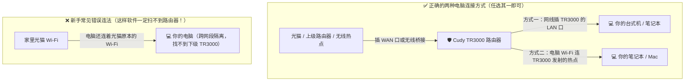
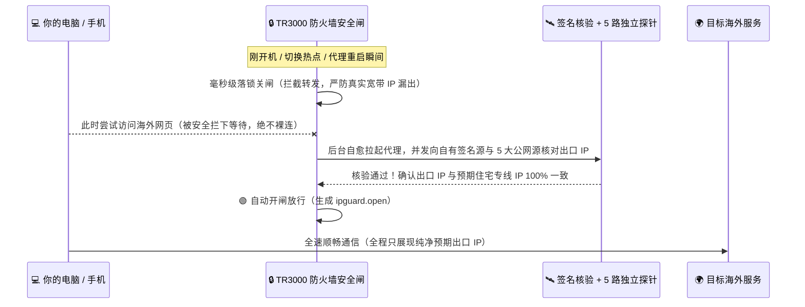

<div align="center">


### 🛡️ TR3000 专用 · 零门槛掌控你的网络出口、无线桥接、固定选路与多维工作台

**✨ 多源签名出口门禁 · 30 秒防锁死无线桥接 · 节点固定路由器持久化 · Windows & macOS 双端原生 ✨**

<br />

[](https://github.com/2014-y/Guardline-Status/releases/latest)
[](#32-%E7%AC%AC%E4%BA%8C%E6%AD%A5windows-%E7%94%B5%E8%84%91%E4%BF%9D%E5%A7%86%E7%BA%A7%E5%AE%89%E8%A3%85%E4%B8%8E%E5%8D%87%E7%BA%A7%E6%95%99%E7%A8%8B)
[](#33-%E7%AC%AC%E4%BA%8C%E6%AD%A5%E8%8B%B9%E6%9E%9C-mac-%E7%94%B5%E8%84%91%E4%BF%9D%E5%A7%86%E7%BA%A7%E5%AE%89%E8%A3%85%E4%B8%8E%E9%A6%96%E6%AC%A1%E6%94%BE%E8%A1%8C%E6%95%99%E7%A8%8B)
[](#-%E7%AC%AC%E5%85%AB%E7%AB%A0%E6%97%A5%E5%B8%B8%E4%BD%BF%E7%94%A8%E5%A5%BD%E4%B9%A0%E6%83%AF%E5%8D%87%E7%BA%A7%E5%8D%B8%E8%BD%BD%E4%B8%8E%E7%B3%BB%E7%BB%9F%E8%A6%81%E6%B1%82)
[](#-%E7%AC%AC%E5%85%AD%E7%AB%A0%E5%BA%95%E5%B1%82%E5%AE%89%E5%85%A8%E5%AE%88%E6%8A%A4%E6%9C%BA%E5%88%B6%E5%A4%A7%E7%99%BD%E8%AF%9D%E7%A7%91%E6%99%AE)
[](LICENSE)

<br />

[📖 新手三分钟读懂](#-第一章三分钟认识-guardline-status给第一次接触的新朋友) •
[🆕 v3.4.0 升级亮点](#-第二章v340-里程碑版本升级全景) •
[🚀 零基础安装登录](#-第三章零基础保姆级安装与首次连接教程手把手一步不跳) •
[🏠 四大组网场景](#-第四章四大真实生活与办公组网场景全攻略) •
[🧩 14 大模块详解](#-第五章14-大功能模块与顶部工具栏逐页深度说明书) •
[🛡️ 安全机制科普](#-第六章底层安全守护机制大白话科普) •
[❓ 排障速查字典](#-第七章新手常见问题与排障速查字典16-问-16-答)

<br />


<sub>📸 文档内展示截图均采用虚构演示设备、RFC 5737 标准测试网段 IP 与模拟流量数据，不包含任何真实用户数据</sub>

</div>

<br />

> [!IMPORTANT]
> **给新手朋友的定心丸**：你完全不需要懂任何网络命令行、不需要懂什么是 OpenWrt 或 SSH、也不需要在电脑上安装 Python 等任何编程环境。**Guardline Status** 就像你平时用的微信、音乐播放器一样，是一个安装在 **Windows 10/11** 或 **苹果 Mac** 电脑上的原生桌面软件——装好打开、输入你的设备密钥，就能在一个清爽直观的窗口里管好整台 **TR3000 专用路由器**。

---

## 📑 全文阅读导航目录

为了照顾第一次拿到设备的新手朋友，同时方便老用户快速查阅具体功能，本说明手册按「从零上手 → 场景实战 → 逐页说明书 → 故障自查」的顺序编写：

1. [**第一章：三分钟认识 Guardline Status（给第一次接触的新朋友）**](#-第一章三分钟认识-guardline-status给第一次接触的新朋友)
   - 它是做什么的、解决哪些痛点、核心网络名词大白话扫盲（WAN / LAN / 无线桥接 / 出口门禁 / 设备密钥）
2. [**第二章：v3.4.0 里程碑版本升级全景**](#-第二章v340-里程碑版本升级全景)
   - 苹果 Mac Universal2 原生双架构、手动固定出口持久化、14 大全景工作台模块、内置离线 WebView2 装上即用
3. [**第三章：零基础保姆级安装与首次连接教程（手把手一步不跳）**](#-第三章零基础保姆级安装与首次连接教程手把手一步不跳)
   - 下载选包对照表、Windows SmartScreen 蓝色提示放行、Mac 首次打开放行、物理接线避坑图解、首次签署与登录
4. [**第四章：四大真实生活与办公组网场景全攻略**](#-第四章四大真实生活与办公组网场景全攻略)
   - 居家有线宽带 + 无线热备、酒店出差无线桥接（含认证热点技巧）、4G/5G 户外移动组网、外出未带路由器应急模式
5. [**第五章：14 大功能模块与顶部工具栏逐页深度说明书**](#-第五章14-大功能模块与顶部工具栏逐页深度说明书)
   - 信息面板、状态面板（路由器/本机双视角）、无线桥接、无线管理、代理节点（设为出口/恢复自动择优）、流量统计、实时连接、终端设备、账号中心、工作空间、系统配置、本机代理、远程协助、关于系统与顶部快捷工具栏
6. [**第六章：底层安全守护机制大白话科普**](#-第六章底层安全守护机制大白话科普)
   - 为什么刚切网前十几秒打不开网页反而是它在保护你？七大异常场景自动自愈时间表与本机硬件级加密说明
7. [**第七章：新手常见问题与排障速查字典（16 问 16 答）**](#-第七章新手常见问题与排障速查字典16-问-16-答)
   - 连不上设备、忘记关电脑 VPN、账号中心显示已禁用、Mac 提示已损坏、旧版路由器提示升级等一站式解决
8. [**第八章：日常使用好习惯、升级卸载与系统要求**](#-第八章日常使用好习惯升级卸载与系统要求)

---

## 📖 第一章：三分钟认识 Guardline Status（给第一次接触的新朋友）

### 1.1 一句话讲明白它是干什么的

你手里的 **Cudy TR3000（Guardline 定制系统）** 是一台自带出口安全防护、自动分流与断电自愈能力的专用便携路由器。为了防止误改底层安全规则导致真实宽带 IP 裸连暴露，Guardline 路由器在日常工作时处于**安全锁定状态**（关闭了传统复杂的英文/专业参数网页后台）。

而 **Guardline Status** 就是专门为这台路由器量身打造的 **电脑端图形化遥控器与全景仪表盘**。通过网线或 Wi‑Fi 连上你的路由器后，你可以在电脑桌面上实时看清网络状态、给路由器连上级 Wi‑Fi、改自家 Wi‑Fi 名字密码、测速并固定代理出口节点、查看分流流量账单，以及使用内置的多账号管理与独立工作空间。

### 1.2 没有它 vs 有了它：日常使用中的 8 个真实对比

| 日常遇到的场景 | 😫 传统路由器后台的做法与痛点 | 😎 用 Guardline Status 的体验 |
| :--- | :--- | :--- |
| **去酒店或换办公室，想让路由器连现场 Wi‑Fi** | 要进四五层专业网络设置菜单选频段、加密协议、接口绑定；**一旦输错一位 Wi‑Fi 密码，路由器直接断联锁死，只能捅复位孔重配** | 点左侧「**无线桥接**」→「**扫描附近热点**」→ 选 Wi‑Fi 输密码即可。**万一输错密码或 30 秒没拿到地址，路由器自动恢复原状，绝不失联** |
| **宽带半夜重拨、上级断网或代理波动瞬间** | 普通路由器会在代理失效瞬间退回本地宽带直连，你的**真实家庭/办公宽带公网 IP 在不知不觉中裸奔暴露** | **出口安全门禁（Kill-Switch）**毫秒级关闸阻断外网转发；后台自动自愈重连并经多源交叉核验出口一致后，才重新开闸放行 |
| **觉得某个节点特别顺手，想一直固定用它** | 手动切完节点，只要路由器断电重启、网络波动重载，又被自动测速换成了别的节点 | 在「住宅固定出口」点节点抽屉的 **「设为出口」**，选择直接**持久化保存在路由器里**，断电重启后依然自动选回它；想换回自动随时点 **「恢复自动择优」** |
| **想知道家里/工作室这个月到底用了多少代理流量** | 路由器一断电或重启，后台内存里的流量统计全部归零，月底根本没法跟套餐账单核对 | 内核旁路零损区分「代理流量 / 直连流量 / 总流量」并自动存入电脑本地数据库，**断电重启不丢一字节**，6 档时间粒度一键导出桌面 Excel/CSV 表格 |
| **家里电脑、手机、平板好几台，想看谁在占网速或防蹭网** | 只看得到一串看不懂的 `AA:BB:CC` 硬件地址和内网 IP，分不清哪个是自己的手机、哪个是陌生设备 | 点击设备旁的 `✎` 就能标上 **「主力办公本」「客厅 iPad」** 等中文名字，全界面同步显示单机实时网速，发现陌生蹭网设备一键 **「禁网」** |
| **电脑不小心还开着别的 VPN 或代理软件，怕串 IP** | 电脑代理叠加软路由代理，极易引发链路冲突、分流错乱甚至污染业务账号环境，自己却毫无察觉 | 内置实时环境冲突巡检：一旦检测到电脑私开了系统代理（如 `127.0.0.1:7890`）或虚拟网卡 VPN，底部立即醒目告警并**自动暂停禁用账号中心内核**，严防环境污染 |
| **网络出问题想截图发给朋友或客服帮忙看看** | 截图里全是自己的真实住宅出口 IP、上级宽带 IP、MAC 地址，直接发出去有隐私泄露风险 | 点击窗口右上角 **「小眼睛」图标**，全界面所有公网/内网 IP、MAC 地址瞬间打码变成 `122.***.***.53`，安心截屏零顾虑 |
| **想同时管理家里一台、工作室一台多台 TR3000** | 每次换地方都要重新输网关地址和长长的密码，容易记混 | 支持加密记住多台路由器的网关与设备密钥，在「系统配置」里点一下就能秒切不同设备 |

### 1.3 新手必读：5 个核心概念大白话扫盲

第一次接触软路由的新朋友，花 1 分钟看完下面这 5 个词，后面所有操作都会一目了然：

1. **WAN 口（上级进水口）与 LAN 口（下级出水口）**：
   - 把路由器想象成家里的净水器。机身背面标着 **`WAN`** 的网口是「进水口」，用来插**光猫或公司墙上网口**引来外网；标着 **`LAN`** 的网口是「出水口」，用来插网线连**你的台式机或笔记本电脑**，给电脑提供净化分流后的网络。
2. **无线桥接（不插网线也能引来外网）**：
   - 如果你出差住酒店、或者路由器放在离光猫很远的房间没法拉网线，可以让 TR3000 用无线方式去连接酒店 Wi‑Fi、上级路由器 Wi‑Fi 或你的手机热点来上网——这就叫「**无线桥接**」。桥接成功后，TR3000 自己依然会发射独立的专属 Wi‑Fi 供你的电脑和手机连接。
3. **双线热备（有线 + 无线双保险）**：
   - 你可以既在 WAN 口插着光猫网线（作为**主出口**），又在「无线桥接」里连好家里的备用 Wi‑Fi 或手机热点（作为**热备在线 Standby**）。平时走有线宽带高速稳定；万一光猫断网或网线松动，TR3000 会自动无缝切到无线热备线路继续工作，网络不断流。
4. **出口安全门禁（Kill-Switch 安全闸）**：
   - 这是 Guardline 最核心的安全护城河。它的原则只有一句话：**「宁可短暂断网等待，也绝不用错误的真实 IP 发出一包海外数据」**。当门禁显示绿色的 **「门禁已放行 (`ipguard.open`)」** 时，代表当前公网出口已经过多源核验确认安全无误；当刚开机或刚切网显示等待核验时，外网会暂时被拦住十几秒，核验通过后自动放行。
5. **设备密钥（普通模式管理密码）**：
   - 就是设备交付给你时配套的专属管理口令。打开 Guardline Status 登录时，保持默认的 **「普通模式」**，在「管理密码」一栏填入这串密钥即可安全连接路由器。

---

## 🆕 第二章：v3.4.0 里程碑版本升级全景

相比早期的 `v3.3.x` 版本，**Guardline Status v3.4.0** 完成了一次从底层引擎到桌面体验的全面跨代升级：

| 升级维度 | v3.4.0 全新特性说明 |
| :--- | :--- |
| 🍎 **macOS Universal2 原生双架构** | 告别旧版单一架构限制，全新打包为 **Apple Silicon（M1 / M2 / M3 / M4）+ Intel（x86_64）双架构通用原生应用**（支持 macOS 10.15 Catalina 至最新 macOS 15 Sequoia），双端界面、功能与安全组件 100% 同步。 |
| 📌 **节点手动固定 & 路由器持久化** | 在 Guardline 策略的「住宅固定出口」组中，新增节点详情抽屉 **「设为出口」** 与 **「恢复自动择优」** 按钮。选定的节点直接保存在路由器闪存配置中，**代理重启、断网重连、拔电源重启后均自动恢复所选节点**；若该节点临时故障，自动回退其他可用节点确保不断网。 |
| 🧭 **14 大一体化全景模块** | 在原有监控、桥接、无线、节点、流量、连接、设备、配置基础上，重磅整合 **「信息面板」**（四段全链路拓扑图）、**「账号中心」**（多账号独立环境秒切）、**「工作空间」**（独立指纹身份归档 `.glid` 与区域对齐）、**「本机代理」**（内置双端 Mihomo 内核）与 **「远程协助」**（ToDesk / 向日葵快捷台）。 |
| 🛡️ **环境防冲突自动熔断保护** | 后台每秒巡检电脑本机网络环境：一旦发现电脑同时开启了系统代理、WinHTTP 代理、第三方代理核心或 TUN 虚拟网卡，立即弹出底部防冲突提示并**自动暂停禁用账号中心内核**，杜绝代理叠穿引发风控。 |
| 📦 **内置离线运行时 · 真正装上即用** | Windows 安装包内置微软官方数字签名的 **Edge WebView2 离线安装包**，即便在断网环境或精简版 Windows 10 上也能一键静默补齐界面引擎；主窗口与安装向导全面引入原生锚点拖动循环（`rp_drag.dll`），150%/175% 高缩放屏幕自适应居中、拖动丝滑跟手零延迟。 |
| 🔐 **多源签名出口核验 & 热补丁同步** | 配合新版路由器系统支持自有签名出口核验（`own=`）与 5 路公网探针交叉复核，彻底消除单一第三方测速网站故障引发的误判；连接新版面板即可静默保持安全组件同步。 |

---

## 🚀 第三章：零基础保姆级安装与首次连接教程（手把手一步不跳）


### 3.1 第一步：确认电脑系统并下载对应的安装包

请点击前往本仓库的 [**Releases 最新版发布页 (v3.4.0)**](https://github.com/2014-y/Guardline-Status/releases/latest)，在页面下方的 **Assets（资源文件）** 列表中，根据你手头的电脑选择下载（**只需要下载你对应系统的那 1 个文件即可**）：

| 你用的电脑类型 | 请下载这个文件 | 文件大小 | 适用范围说明 |
| :--- | :--- | :---: | :--- |
| 🪟 **Windows 电脑**<br>（台式机 / 华为、联想、戴尔、华硕等笔记本） | **`Guardline-Status-v3.4.0-Setup.exe`** | 约 `339 MB` | 支持主流 64 位 **Windows 10 / Windows 11**。之所以体积约 339 MB，是因为里面完整内置了微软官方离线界面运行库与全部组件，确保在任何新电脑上**不联网也能装上即用**。 |
| 🍎 **苹果 Mac 电脑**<br>（MacBook Air / Pro、Mac mini、iMac、Mac Studio） | **`Guardline-Status-macOS-v3.4.0-Universal2.dmg`** | 约 `70 MB` | **Universal2 通用版**：无论是苹果自研 **M1 / M2 / M3 / M4 芯片**还是老款 **Intel 芯片**的 Mac，全都下载这同一个 `.dmg` 文件即可（支持 macOS 10.15 及以上系统）。 |

> [!TIP]
> **给新手的小提示**：如果你在 GitHub Releases 页面看到 `Source code (zip)` 和 `Source code (tar.gz)`，那是 GitHub 自动生成的说明文档压缩包，里面**没有软件安装程序**，请勿下载那两个文件，一定要下载上面表格里以 **`.exe`** 或 **`.dmg`** 结尾的安装包。

---

### 3.2 第二步（Windows 电脑）：保姆级安装与升级教程

1. **双击打开安装包**：在电脑的「下载」文件夹里找到刚下好的 **`Guardline-Status-v3.4.0-Setup.exe`**，鼠标左键双击它。
2. **如果弹出蓝色窗口「Windows 已保护你的电脑」怎么点？（非常关键）**：
   - 这是微软 Windows 自带的 SmartScreen 筛选器对未购买商业机构数字证书的新安装包弹出的常规提醒，并非病毒或故障。
   - **放行步骤**：先用鼠标点击窗口偏左中间带下划线的小字 **「更多信息」** → 此时窗口右下角会出现一个按钮 **「仍要运行」**，点击 **「仍要运行」** 即可（同一台电脑只需要点这一次，以后打开桌面图标不会再弹）。
3. **按图形向导一键装完**：
   - 安装向导打开后，勾选同意软件使用条款，直接点击 **「立即安装」**（默认安装在当前用户的 `%LOCALAPPDATA%\Programs\RouterPanel` 目录下，全程无需复杂的管理员配置，你也可以自定义安装文件夹）。
   - 如果你的电脑是未装 Edge 浏览器的精简版系统，向导会自动在后台静默安装内置的微软官方 WebView2 组件，稍等片刻即可在桌面生成橙色图标的 **「Guardline Status」** 快捷方式。
4. **老用户如何升级新版本？**：
   - **完全不需要先卸载旧版！** 直接双击新版 `Guardline-Status-v3.4.0-Setup.exe` 安装即可。向导会自动平顺关闭正在运行的旧窗口并替换程序文件，**你以前保存过的设备连接记录、Wi‑Fi 热点记忆库、内网设备中文备注名以及历史流量统计数据库都会 100% 原封不动保留**。

<details>
<summary>🛠️ 进阶技巧：Windows 命令行无人值守静默安装（适合工作室多台电脑批量部署）</summary>

如果你需要在多台工作电脑上快速部署升级、不想手动点向导界面，可以在 PowerShell 或命令提示符中加 `--silent` 参数运行：

```powershell
.\Guardline-Status-v3.4.0-Setup.exe --silent
```

程序会在后台自动补齐依赖、完成程序安装或覆盖升级、创建桌面与开始菜单快捷方式，执行完毕后自动退出。

</details>

---

### 3.3 第二步（苹果 Mac 电脑）：保姆级安装与首次放行教程

1. **拖入应用程序文件夹**：
   - 双击下载好的 **`Guardline-Status-macOS-v3.4.0-Universal2.dmg`** 镜像文件。
   - 在弹出的安装窗口中，用鼠标按住左侧的 **`Guardline Status`** 应用图标，把它**拖拽到右侧的 `Applications`（应用程序）文件夹图标上松手**，等待几秒钟复制完成。
2. **首次打开必看：解决苹果「无法验证开发者」或「已损坏」拦截提示**：
   - 因为苹果 macOS 系统默认会拦截未缴纳苹果开发者年费公证的独立分发应用，**仅仅在安装后第一次打开时**需要手动放行一次（放行后以后每次在启动台或访达直接双击就能秒开）：
   - **情况 A（你的系统是 macOS 14 Sonoma、macOS 13 Ventura 或更早版本）**：
     1. 打开 **「访达 (Finder)」** → 点击左侧栏的 **「应用程序 (Applications)」**。
     2. 找到 **`Guardline Status`**，**按住键盘上的 `Control` 键再用鼠标点击它（或者直接双指右键点击它）**，在右键菜单里点击 **「打开」**。
     3. 在弹出的灰色确认框中，再点一次 **「打开」** 按钮，软件就会顺利启动。
   - **情况 B（你的系统是最新的 macOS 15 Sequoia 及更高版本）**：
     1. 先在「应用程序」里双击一次 `Guardline Status`，弹出「未打开 Guardline Status」提示时点击 **「完成」**（不要点移到废纸篓）。
     2. 点击屏幕左上角苹果图标 `` → 打开 **「系统设置」** → 点击左侧的 **「隐私与安全性」**。
     3. 向下滑动页面到底部「安全性」区域，你会看到一行提示 **「已阻止使用“Guardline Status”，因为来自身份不明的开发者」**，点击旁边的 **「仍要打开」** 按钮，验证一下你的 Mac 开机密码或指纹，再点 **「仍要打开」** 即可。
   - **情况 C（最省事的一招通吃法，或遇到提示「“Guardline Status”已损坏，无法打开」时）**：
     1. 按下键盘 `Command (⌘) + 空格键` 打开聚焦搜索，输入 **`终端`**（或 `Terminal`）回车打开系统自带终端。
     2. 完整复制下面这一行命令，粘贴进终端窗口后按回车键执行（执行成功不会报错，直接回到下一行提示符）：
        ```bash
        xattr -dr com.apple.quarantine "/Applications/Guardline Status.app"
        ```
     3. 关掉终端，再去「应用程序」里双击 `Guardline Status`，就能直接顺畅打开了！

---

### 3.4 第三步：把电脑连到你的 TR3000 路由器（新手最容易踩坑的一步！）

在打开软件登录之前，请先确认你的电脑已经在物理上连到了 **TR3000 这台路由器自己的网络里**。下面用最直观的图解告诉你什么是**对的连法**、什么是**错的连法**：



- **✅ 正确连法一（有线连法，台式机或有网口的笔记本推荐）**：准备一根网线，一头插在 **TR3000 背面的 `LAN` 口**，另一头插在你的电脑网口上（如果台式机同时开着连光猫的 Wi‑Fi，建议把电脑连光猫的旧 Wi‑Fi 断开或取消自动连接，优先走 TR3000）。
- **✅ 正确连法二（无线 Wi‑Fi 连法，MacBook 或轻薄本推荐）**：确保 TR3000 已插电开机约 1 分钟（机身指示灯亮起），在电脑右下角（Windows）或右上角（Mac）点开 Wi‑Fi 列表，找到 **TR3000 自己发射的 Wi‑Fi 名称** 输入密码连上。
- **⚠️ 特别检查一件事**：请把你电脑上以前装过的**第三方 VPN、加速器、Clash Verge / v2rayN / Shadowrocket 等本地代理软件彻底退出关闭**！因为你现在已经有硬件级路由保护了，电脑上再开代理软件不仅多余，还会抢占流量甚至妨碍电脑访问局域网网关。

---

### 3.5 第四步：首次启动服务协议签署与「普通模式」一键登录

1. **双击打开 `Guardline Status`**：
   - 第一次启动时，屏幕正中央会弹出 **《用户服务协议与安全运维日志隐私政策》** 窗口。
   - 请阅读协议说明后，勾选下方的复选框，并在输入框里手动输入汉字 **「同意」** 两个字，然后点击 **「确定」** 按钮（该步骤仅在首次安装时出现一次，确认后永久记住）。
2. **自动发现网关并登录**：
   - 随后自动进入 **「连接 Guardline 路由器」** 登录窗口：
     - **网关地址**：软件会自动探测当前局域网内的 TR3000 地址（默认通常是 **`192.168.88.1`**，探测到后会显示为快捷小标签，点一下标签就会自动填入；若没自动跳出，手动输入 `192.168.88.1`、端口保持 `22` 即可）。
     - **登录模式**：保持顶部选中的 **「普通模式」**（日常使用全部选普通模式；旁边的「管理员模式」仅供技术人员做底层维护排障使用）。
     - **管理密码（设备密钥）**：输入设备交付时给你的专属**设备密钥**（Mac 端和 Windows 端都可以点输入框右侧的小图标切换显示明文核对有没有输错大小写或空格）。
     - **记住密码**：建议保持勾选（密码会使用你这台电脑独有的系统硬件密钥加密保存，别人拷走文件也解不开，下次打开软件就能自动秒连，不用再输）。
   - 点击橙色的 **「立即登录」** 按钮！
3. **确认连接成功**：
   - 等待 2～3 秒钟，登录弹窗自动收起，进入主界面。看一眼窗口**左下角的状态栏**：当圆点变成**翠绿色**，显示 **「普通用户 · 已连接 · 时间」**，就说明你已经成功连上你的 TR3000 了！

---

## 🏠 第四章：四大真实生活与办公组网场景全攻略

不同用户的网络环境千差万别，不管你是在固定工位办公，还是背着包全国各地住酒店出差，都可以直接照抄下面对应的方案：

### 场景一：居家 / 工作室固定宽带主力组网 + 无线热备双保险（最稳推荐）

适合有固定光纤宽带、追求极致低延迟与 7×24 小时不断网的用户：

1. **主线路（有线 WAN）**：拿一根网线，一头插在家里光猫或公司交换机的 LAN 口上，另一头插在 **TR3000 背面的 `WAN` 口** 上。插好后无需任何设置，TR3000 会自动获取上级地址并将其设为绿色的 **「有线 WAN · 主出口」**。
2. **备用线路（可选，强烈推荐给重度办公用户）**：打开 Guardline Status 左侧的 **「📡 无线桥接」** 页面，点击「扫描附近热点」，把工作室的另一条宽带 Wi‑Fi（或者你放在桌边的备用手机热点）连上。
3. **最终效果**：在「信息面板」顶部你会看到绿色的 **「双线热备在线」** 标识——平时 100% 流量走高速稳定的有线网口；一旦哪天宽带光猫突然断网或网线松脱，路由器会自动无缝切到无线热备热点顶上，等宽带恢复后再自动切回有线主线路，全程安心无感。

### 场景二：酒店出差 / 民宿 / 临时办公场地纯无线桥接组网

出差住酒店时房间往往没有网线口，或者网线口在电视柜后面够不着，这时完全不需要插 WAN 口网线：

1. 把 TR3000 插上电源开机，你的笔记本电脑连上 **TR3000 自己的 Wi‑Fi**。
2. 打开电脑上的 **Guardline Status** 登录，点击左侧栏的 **「📡 无线桥接」**。
3. 点击右上角的 **「扫描附近热点」** 按钮，等待几秒钟列表中刷出酒店房间的 2.4G / 5G Wi‑Fi。
4. 点击酒店 Wi‑Fi 右侧的 **「连接」**，输入酒店前台给你的 Wi‑Fi 密码，点确定。
5. **防失联兜底**：等待约 10～20 秒，看到桥接状态变成 **「已连接」** 且信息面板顶部「出口与门禁」亮起绿灯 **「门禁已放行」**，你的电脑、手机、平板连着 TR3000 的 Wi‑Fi 就全部可以正常高速工作了！（哪怕刚才不小心把酒店 Wi‑Fi 密码输错了一位，30 秒后路由器也会自动回退原状，你的电脑跟 TR3000 的连接完全不会断，直接重输一次正确密码即可）。

> [!NOTE]
> **住连锁酒店遇到「需要弹网页输手机号收短信验证码」的公共 Wi‑Fi 怎么办？**
> 无线桥接支持所有常规密码加密（WPA / WPA2 / WPA3）和免密开放热点，但路由器本身无法代替人在酒店弹窗网页里收填手机短信验证码（Portal 认证）。遇到这种酒店 Wi‑Fi 时，教你一招最简单的破局法：
> 1. 先拿你的**安卓手机**（或笔记本/随身 Wi‑Fi）连上酒店 Wi‑Fi，在手机弹出的网页里输完手机号验证码完成认证；
> 2. 打开这部手机的 **「个人热点」**（注意安卓大厂旗舰机基本都支持「连着酒店 Wi‑Fi 的同时开个人热点共享 Wi‑Fi」；苹果 iPhone 开启个人热点会自动切蜂窝流量，若用 iPhone 可直接用数据线插 TR3000 侧面的 USB 口共享）；
> 3. 在 Guardline Status「无线桥接」里让 TR3000 连上你刚开的手机热点即可！以后再来同一家酒店，因为记忆库已存好你的手机热点密码，插电就会自动连上。

### 场景三：户外移动 / 展会摊位 / 车载无宽带组网

在完全没有固定宽带也没有现场 Wi‑Fi 的地方：

- **方法 A（插 4G/5G 随身网卡）**：将免驱型 USB 4G/5G 上网卡直接插进 **TR3000 机身侧面的 USB 3.0 接口**，路由器会自动识别为移动蜂窝主出口。
- **方法 B（手机数据线 USB 网络共享）**：用一根支持数据传输的手机充电线，一头插手机、一头插 TR3000 侧面 USB 口：
  - **安卓手机**：插上后在手机「设置 → 移动网络 / 个人热点」里打开 **「USB 网络共享」**；
  - **苹果 iPhone**：插上后打开手机「设置 → 个人热点 → 允许其他人加入」，手机屏幕弹出「要信任此电脑吗？」时点击 **「信任」** 并输入锁屏密码。
  等待十几秒门禁核验放行后，全场多台办公设备即可同时共享这台路由器的安全出口。

### 场景四：临时外出喝咖啡没带 TR3000 路由器怎么办？

万一你只背了笔记本电脑出门、没带 TR3000 硬件，Guardline Status `v3.4.0` 也为你准备了独立的应急方案：

1. 直接打开电脑上的 `Guardline Status`，在弹出的登录框底部点击免路由独立功能入口进入 **「⚡ 本机代理」** 页面。
2. 程序已经内置了双端原生的 Mihomo 代理引擎，导入你的备用配置后即可在电脑本地测速并开启代理。
3. **⚠️ 重要提醒**：当你回到家里或工作室、重新连回 **TR3000 软路由** 时，请务必先去「本机代理」里把电脑本地代理**关闭**，让流量完全交回给 TR3000 硬件路由器统一接管，避免电脑代理与路由器叠加冲突！

---

## 🧩 第五章：14 大功能模块与顶部工具栏逐页深度说明书

打开软件主界面后，左侧导航栏整齐排列着 **14 个一级功能页面**（支持在设置中按个人习惯调整顺序）。下面带你一页一页认识每个按钮和数字的含义：

---

### 5.1 🧭 信息面板（全局健康总览与四段动态拓扑）

这是你登录成功后最直观的「驾驶舱总控台」，由五大核心卡片组成：

1. **全链路网络拓扑（顶部横跨卡片）**：
   从左到右把数据包走过的每一站画成直观的四段动态流向图：
   - **第一站 · 上级接入**：显示当前主用外网入口（如绿标 `有线 WAN` 及光猫分配的 IP），下方小字同时展示无线热备状态（如 `热备: YUAN`）。
   - **第二站 · 核心路由**：显示 TR3000 内网管理地址（如 `192.168.88.1`）、硬件型号 `Cudy TR3000 256MB v1`、当前并发转发的 `NAT 会话数` 与连续稳定运行时长。
   - **第三站 · 出口与门禁**：最关键的一格！绿标 **「门禁已放行」** 加上预期住宅公网出口 IP、探针一致性（如 `5/5 探针一致`）以及当前正在使用的出口节点名，让你一眼确认出口 100% 纯净合规。
   - **第四站 · 接入终端**：显示当前连在 TR3000 名下的总设备台数（区分无线几台、有线几台）与实时总吞吐速率。
2. **硬件与系统内核卡片（新手怎么看路由器累不累？）**：
   - **CPU 占用**：日常浏览网页、看视频一般在 `5% ～ 35%` 之间，大文件满速下载时升至 `50% ～ 80%` 均属健康状态。
   - **系统内存**：TR3000 拥有 `256 MB`（可用总计约 `240～485 MB` 视系统内存统计口径）大内存，占用在 `50% ～ 75%` 以内都非常充裕。
   - **SoC 温度**：便携路由器无风扇静音散热，芯片内部传感器温度在 **`48 °C ～ 75 °C`** 之间都属于完全正常的工作温度（夏天室温高时略高，放在桌面通风处别捂在被子或包里即可）。
   - **NAT 活动会话**：展示当前并发网络连接占系统上限（`4096`）的比例条。
3. **上网线路与网关接口卡片**：
   分四个象限清晰列出 **有线 WAN**（主出口）、**无线桥接**（热备在线 / 主出口）、**IPv6 WAN**（默认显示 **「已关闭 · 单栈路由保护」** —— 这是故意关闭的！用来彻底杜绝运营商 IPv6 绕过代理产生真实地址泄露，请勿担心）以及 **LAN (br-lan)** 内网核心状态，右上角实时跳动外网连通延迟毫秒数。
4. **双频热点 (AP) 卡片**：
   并排展示 `2.4 GHz 广覆盖` 与 `5 GHz 高速率` 两个频段的发射状态、Wi‑Fi 名称、信道（如信道 `4` / `36`）、频宽（`HE20` / `HE80` Wi‑Fi 6 制式）、发射功率（如 `23 dBm`）及各自挂载的终端数量。
5. **代理引擎与出口门禁卡片**：
   汇总展示门禁放行状态、策略分组数、代理节点总数与当前测速可用数（如 `可用 81 / 98`）、生效分流规则数与活跃连接数，右上角提供快捷按钮 **「重验门禁」** 与 **「更新订阅」**。

---

### 5.2 📊 状态面板（「路由器 / 本机」双视角波形与一键出口体检）

点击左侧栏第二项进入「状态面板」，这里最大的亮点是标题右侧的 **「路由器 / 本机」双视角切换开关**：

- **视角 A：路由器全局视角（默认）**
  - **实时上下行平滑速率波形**：以秒级刷新绘制全网实时下载（下行）与上传（上行）速度曲线，峰值与均值一目了然。
  - **🩺 网络出口与连通性体检**：点击顶部的体检按钮，软件会自动在几秒钟内完成一套全方位体检——包括当前出口 IP 归属国家城市、运营商 ASN 原生住宅/机房属性判定、多源探针一致性比对、IPv6 / WebRTC / DNS 路由安全性检查，以及主流海外平台的实时响应延迟，并支持**一键复制纯文本体检报告**（若开启了隐私小眼睛，复制出的报告也会自动打码 IP）。
- **视角 B：本机专属视角（只看当前这台电脑！）**
  - 当怀疑「是不是我这台电脑上有某个后台软件在偷跑流量或绕过了路由器？」时，点一下切到 **「本机」**：
  - 它通过操作系统原生网络接口（无需额外抓包驱动）展示**专属于当前电脑**的出口 IP（并自动与路由器出口 IP 比对是否一致）、本机网卡实时速率曲线、出站路径判定（经由路由器 / 本机代理 / 虚拟网卡）、系统代理与虚拟网卡状态，以及精确到每一个 `.exe` / 应用进程的 **「实时连接 / 最近请求 / DNS 查询缓存」**，还能按源端口自动和路由器的分流会话对应起来，查问题清清楚楚。

---

### 5.3 📡 无线桥接（30 秒防锁死回滚 + 常用热点记忆库）

专为移动办公、差旅酒店以及家庭无线中继热备设计：

1. **一键扫描与信号分级**：点击「扫描附近热点」，自动同时扫描周边 `2.4G` 与 `5G` 无线网络，自动过滤路由器自己发射的信号，按「当前已连 → 记忆库已存 → 信号质量由强到弱」智能排序，完整支持含中文、空格、Emoji 或特殊字符的 Wi‑Fi 名称。
2. **隐藏热点连接**：如果公司的上级 Wi‑Fi 设置了「隐藏网络名称（不广播 SSID）」，点击「连接隐藏热点」手动填入 Wi‑Fi 名称、频段（2.4G 或 5G）、加密方式与密码即可连接。
3. **30 秒无线快照防失联保护（核心黑科技）**：
   每次点击连接新热点前，路由器都会先拍下一张当前好用的无线配置快照。下发新热点后开始 30 秒倒计时检测——如果因为**密码输错、信号太弱或上级路由没给分配 IP**导致 30 秒内没连上，路由器会自动把刚才拍下的快照还原回去，你的电脑不会断联，重新点连接改一下密码就行。
4. **常用热点加密记忆库 & 自动回连**：
   凡是成功连上过的热点（家里、公司、手机热点），密码都会自动加密存入记忆库（最多保留最近 20 个常用热点）。在已存列表里可以一键免输密码秒切；打开 **「自动扫描连接记忆库 Wi‑Fi」** 开关后，带着 TR3000 从家里到公司插电开机，它扫到公司熟悉的 Wi‑Fi 就会自动连上！

---

### 5.4 📶 无线管理（管理 TR3000 自己发射的 Wi‑Fi 热点）

这里管的是**你的手机、电脑连接 TR3000 时所看到的那个 Wi‑Fi**：

- **双频合一开关（新手强烈推荐开启）**：
  - **开启双频合一**：`2.4G` 和 `5G` 共用同一个 Wi‑Fi 名字和同一串密码。你在客厅离路由器近时，手机电脑自动连高速 `5G`；走到卧室隔了两堵墙时，自动平滑切到穿墙能力强的 `2.4G`，省心省事。
  - **关闭双频合一**：可以把 `2.4G` 和 `5G` 改成两个不同的名字（比如后面加 `-5G`），方便固定让办公电脑只连高速 5G 频段。
- **2.4G / 5G 独立发射大开关**：想关掉某一个频段的发射只需点一下开关。**请放心：哪怕你因为全用网线而把本机发射开关关掉，也绝对不会影响「无线桥接」正在连接的上级热点！**
- **改名、改密码与快捷复制**：Wi‑Fi 密码要求 `8 ～ 63` 位字符，支持点击一键显示密码或复制密码发给同事；修改保存后连着 Wi‑Fi 的设备会短暂重连一下（用新密码重连即可）。
- **高级射频设置**：支持隐藏本机 Wi‑Fi 名称（防外人搜到）、三档发射功率调节（穿墙增强 / 标准 / 节能），以及 `5G` 频段 `HE80` 高频宽信道选择（程序已自动为你排除了容易触发雷达避让断流的 DFS 信道，选自动或常用低信道最稳）。

---

### 5.5 🌐 代理节点（并发测速、「设为出口」持久化与订阅同步）

这是管理线路延迟与手动指定出口的核心页面：

1. **看懂并发延迟测速的四种颜色**：
   点击右上角测速按钮，路由器会对组内全部节点发起真实连通延迟测试：
   - 🟢 **绿色（`< 150 ms`）**：极速顺畅，网页秒开、高清视频与实时语音交互首选；
   - 🟡 **黄色（`150 ～ 300 ms`）**：良好可用，日常办公、图文与大模型对话完全流畅；
   - 🟠 **橙色（`> 300 ms`）**：延迟偏高，适合作为备用；
   - 🔴 **红色 / 超时**：当前线路维护或暂不可达（可勾选顶部的「仅显示可用节点」一键隐藏超时节点）。
2. **📌 手动固定出口节点 & 路由器持久化（`v3.4.0` 重磅新功能）**：
   默认情况下，Guardline 的 **「住宅固定出口」** 策略组处于 **「Guardline 自动择优」** 模式——由路由器自动挑选当前可用且延迟最低的节点。如果你希望**手工指定并锁死某一条节点**，按以下三步操作即可：
   - **第一步（打开节点抽屉）**：在节点列表中点击你想用的那张节点卡片（例如 `专线节点-13`），右侧会滑出 **「节点详情」** 抽屉。
   - **第二步（点击「设为出口」）**：点击抽屉右上角醒目的橙色按钮 **「设为出口」**。
     - 瞬间切换生效：该节点立即排到列表第一位并打上 `✓` 对勾，屏幕弹出提示 *「已切换至 XXX，并保存在路由器上（重启、断网恢复后仍使用）」*，同时抽屉右上角的按钮会变成 **「恢复自动择优」**。
     - **真持久化保障**：你的这项选择已写入路由器闪存配置中——就算以后**重启代理、上级 Wi‑Fi 断线重连，甚至拔掉路由器电源再插上**，开机恢复后路由器依然会自动给你选回这条节点！万一某天这条节点临时维护不可用了，路由器会先智能借用其他可用节点保住你的网络不断线，等它恢复正常又能继续用。
   - **第三步（随时改回自动选路）**：什么时候不想固定了，再次点开当前打勾节点的详情抽屉，点击右上角的 **「恢复自动择优」** 按钮，路由器就会立即删掉固定记录，重新回到全自动择优最快节点的省心模式！

> [!TIP]
> **为什么在「节点选择」或「家宽优先」组里点切换会提示去「住宅固定出口」选？**
> 因为 Guardline 系统的主分流架构锁定了顶层总出口策略指向「住宅固定出口」，防止误切到直连或非住宅组导致出口属性变化。所以选节点统一在 **「住宅固定出口」** 组里操作即可（在「全部」视图下点击属于住宅固定出口的节点卡片同样直接显示「设为出口」按钮）！

---

### 5.6 📈 流量统计（跨重启分流账单与 CSV 报表导出）

再也不用担心路由器重启后算不清用了多少套餐流量：

- **三类流量精准剥离**：利用路由器 Linux 内核 `nftables` 硬件级旁路计数器（几乎不占 CPU），将每一字节流量精确拆分为 **「代理流量（走专线出口的海外流量）」**、**「直连流量（走国内宽带直连的国内网站流量）」** 与 **「总流量」**。
- **本机数据库永久归档**：每次打开面板都会自动从路由器同步增量桶数据存入你电脑本地的 `traffic.db` 数据库，哪怕路由器断电、重置，历史账单也稳稳留在电脑里。
- **6 级时间粒度与图表切换**：支持按 **5 分钟、按小时、按天、按月、按季度、按年度** 六种颗粒度查看，支持今日、近 24 小时、近 7 天、近 30 天及精确到分钟的自定义起止时间；提供直观的分流环形占比图与「堆叠总览 / 并列对比」柱状图，点击 **「导出 CSV」** 即可在桌面生成可直接用 Excel / WPS 打开的对账表格。

---

### 5.7 🔍 实时连接（秒级分流透视与定格排障）

当你想知道「某个网站到底走了代理还是走了直连？」或者「哪台设备正在疯狂下载占满带宽？」时，打开「实时连接」：

- 列表实时展示局域网内每一条活跃会话的 **来源设备（直接显示你标的中文名）**、**目标域名与端口**、**命中的分流规则（Rule）**、**最终出口节点**、**实时上下行速度** 与 **单连接累计流量**。
- **实用技巧 ——「暂停刷新」**：由于网络请求每秒都在变化，眼睛容易看花，点一下顶部的 **「暂停刷新」** 就能把当前画面像拍照一样定格住，慢慢搜索域名或点开某条连接查看详情；排查完再点恢复刷新，也可以单条断开或点「清空连接」让所有软件立即按新节点重新握手。

---

### 5.8 💻 终端设备（中文备注名与防蹭网一键管控）

家里或办公室连在 TR3000 上的所有手机、电脑、平板、电视都在这里一目了然：

- **全方位设备画像**：同时展示设备 IP、MAC 地址、连接方式（有线 LAN / 2.4G Wi‑Fi / 5G Wi‑Fi）、无线信号强度（dBm 数值与信号格）以及每台设备当前的实时上传下载网速。
- **绑定自定义中文备注名**：点击任意设备名称旁的小铅笔图标 `✎`，输入如 `我的 MacBook Pro`、`财务台式机`、`工作手机` 保存后，不仅本页显示中文名，连「状态面板」和「实时连接」里也会自动同步显示这个名字！
- **一键禁网 / 恢复联网（带防误锁保护）**：如果发现不认识的陌生蹭网设备，点一下它右侧的 **「禁网」** 即可立即切断它的外网访问权限；随时可点「恢复」解封。系统贴心内置了**操作本机防误锁保护**——不允许你误点把自己正在操作的这台电脑禁网，新手随便点也不用怕把自己踢下线。

---

### 5.9 👤 账号中心（多账号独立环境秒切 & 防代理冲突熔断）

专为拥有多个桌面端 / CLI 命令行工作账号、需要频繁切换且严防环境交叉污染的用户打造，内含 **仪表盘、账号管理、会话记录、用量统计、操作日志、缓存清理、设置** 七大子标签页：

- **免重登一键秒切**：为每个账号维护完全隔离的本地配置、Cookie、LocalStorage、IndexedDB 与命令行符号链接目录（Windows 与 macOS 原生双引擎支持）。添加保存账号快照后，点一下切换按钮就能在不同账号之间瞬间无缝切换，无需反复收验证码重新登录。
- **会话浏览与用量监控**：直观汇总各账号历史会话记录、当前周期使用量占比与操作轨迹，支持安全清理冗余缓存释放磁盘空间。
- **🛑 核心安全护栏 —— 为什么有时左侧「账号中心」会显示红字「已禁用」？**
  如果你看到左侧导航栏「账号中心」旁标着红色 **「已禁用」**，同时窗口底部弹出提示条：
  > *「⛔ 检测到本机系统代理已开启 (127.0.0.1:7890)，账号中心已完全禁用并暂停内核」*
  **请不要慌，这正是软件在保护你的账号安全！**
  原因很简单：你这台电脑上同时打开了 Clash / v2rayN 等本地代理软件（或者开启了第三方 TUN 虚拟网卡、或者电脑脱离了预期路由出口）。如果在这种「代理叠代理」或出口异常的状态下切换和使用账号，极易造成账号出口 IP 跳变风控！
  **解除方法**：把电脑任务栏/菜单栏里开着的第三方代理软件关掉（确保 Windows「设置 → 网络和 Internet → 代理 → 使用代理服务器」处于关闭状态），等待几秒钟（或在系统配置点重检），环境恢复纯净后「账号中心」就会自动解锁恢复可用！

---

### 5.10 🛡️ 工作空间（独立指纹身份归档与区域对齐）

当你需要管理多套相互隔离的浏览器工作身份，或让电脑时区语言与出口地区保持严谨一致时使用：

- **快捷区域对齐**：根据当前出口所在国家/地区，支持在 Windows 与 macOS 上一键对齐系统时区与语言环境参数，避免浏览器时区与出口 IP 地区不匹配。
- **独立浏览器身份空间**：每个身份拥有完全独立的浏览器数据目录与启动引导页，互不共享 Cookie 与本地存储，支持面板内一键启动、状态监控与安全关闭守护。
- **`.glid` 银行级加密归档导入导出**：支持将整套身份环境打包导出为 `.glid` 归档文件（采用 **PBKDF2 600,000 次迭代派生密钥 + AES-256-GCM 认证加密**），方便备份存档或拷贝到你的另一台 Windows / Mac 电脑上输入保护口令无损还原。

---

### 5.11 ⚙️ 系统配置（多设备秒切、线路优先级与故障一键自愈工具箱）

把所有高频维护开关集中在这一页，免去任何复杂操作：

1. **多台 TR3000 加密记忆库**：如果你在家里有一台 TR3000、在公司也有一台 TR3000，两台都登录过一次后就会出现在设备列表里，点一下就能一键切换连接对象，也可以随时移除旧记录。
2. **主备上网线路优先级**：当有线 WAN 网口和无线桥接同时在线时，可以一键设置「有线 WAN 优先（推荐）」或「无线桥接优先」。
3. **三大故障一键自愈工具箱（遇到网络卡顿先点这里！）**：
   - **🔄 重验门禁（重验安全闸）**：刚插好网线或刚连上新热点，如果觉得等自动核验慢，点一下立即触发多源探针重测并开闸放行。
   - **⚡ 重启代理内核**：网页偶发打不开但 Wi‑Fi 信号正常时，点一下平滑重启路由器上的分流代理引擎（约 25～35 秒自动恢复放行，不断 Wi‑Fi）。
   - **🔌 安全重启整台设备**：想给路由器做一次彻底重启时，用这个按钮代替直接拔电源——它会先把路由器内存里的最新分流流量账单安全刷盘保存，再平滑重启系统（约 45～65 秒后自动重连恢复）。
4. **软件偏好设置**：支持一键开启 **「开机自动启动（静默驻留托盘）」**、窗口置顶显示等日常习惯配置。

---

### 5.12 ⚡ 本机代理（外出无路由器时的独立内置内核）

内置开箱即用的跨平台 Mihomo 核心（Windows `x64` 与 macOS `Universal2` 均已随安装包内置，无需额外联网下载内核）：

- 支持独立导入配置文件或订阅链接、节点延迟测速、切换规则/全局模式，支持一键开启「系统代理」或管理员权限下的「TUN 虚拟网卡模式」。
- **新手谨记一条原则**：**「有软路由用软路由，没带软路由才开本机代理」**。平时电脑连着 TR3000 路由器时，保持「本机代理」处于**关闭**状态即可，所有分流与门禁保护已由 TR3000 硬件透明完成。

---

### 5.13 🖥️ 远程协助 & 5.14 ℹ️ 关于系统与顶部快捷工具栏

- **🖥️ 远程协助**：页面自动检测你电脑上是否安装了国内常用的 **ToDesk** 或 **向日葵（Sunlogin）** 远程桌面软件。已安装时点击按钮即可一键唤起客户端窗口，未安装时可一键打开官方下载页。需要请管理员或朋友远程帮你看问题时，先点右上角「小眼睛」开启隐私脱敏，再打开远程协助，既高效又保护隐私。
- **ℹ️ 关于系统**：查看当前客户端版本号（`v3.4.0`）、连接架构、本机数据存放位置与服务协议说明。
- **顶部右侧一排贴心小图标（从左到右）**：
  - **🙈 小眼睛图标（全局隐私脱敏）**：点亮后全界面所有公网 IP、内网 IP、网关地址、MAC 地址全部自动打码遮蔽，再点一下恢复正常显示。
  - **🌙 / ☀️ 月亮太阳图标**：一键在「暖曜暗黑模式」与「清爽浅色模式」之间无缝切换。
  - **🎨 调色盘图标**：内置珊瑚橙（默认）、暖珀金、海洋蓝多套主题强调色，并支持自定义主题色、自定义窗口背景与 **`A-` / `A+`（90% ～ 124%）无级字号缩放**，适配大屏显示器与小屏笔记本。
  - **📌 图钉图标**：一键让窗口始终置顶悬浮在最前面，方便边调网络边看网页测试效果。
  - **`—` / `□` / `×` 窗口控制与托盘常驻**：点击关闭或最小化到系统托盘后，软件以极低资源消耗在后台静默守护，单击屏幕右下角（Windows）或菜单栏（Mac）托盘图标即可 **0 秒无白屏闪烁瞬间唤出**。

---

## 🛡️ 第六章：底层安全守护机制大白话科普

很多新朋友第一次用 Guardline 路由器时会好奇：**「为什么路由器刚插电开机、或者刚切换完无线桥接热点的前二三十秒里，电脑连上了 Wi‑Fi 却暂时打不开海外网页？是不是坏了？」**

答案恰恰相反：**这正是 Guardline 最核心的安全保护机制在正常工作！**

### 6.1 出口安全门禁（Kill-Switch）是如何做到「零裸连泄露」的？

普通路由器在刚开机、宽带重拨或代理进程重启的那十几秒空窗期里，代理还没准备好，系统就会把你的网络请求直接从本地宽带发出去——哪怕只有短短 3 秒钟，远端网站也已经记录下了你真实的国内宽带 IP。

Guardline 在路由器底层防火墙（`nftables`）里装了一道硬件级 **「出口安全闸门」**：



- **多重交叉验证不怕单站抽风**：路由器同时结合自有服务器随机挑战签名回显与 Amazon、ifconfig.me、ipify、ipinfo、Cloudflare 五家独立公网源核验出口 IP。哪怕某几个第三方测速网站临时打不开，也不会误伤断网；但只要有任何一个探针发现出口 IP 不等于预期住宅 IP，闸门立刻死死锁住，做到**宁可短暂等待、绝不漏出一包真实宽带流量**。

### 6.2 七大异常场景全自动自愈实测参考表

在使用过程中哪怕遇到停电、上级光猫重启或网络折腾，你通常什么都不用做，路由器内置的看守与自愈系统会自动帮你修好（以下为 TR3000 真机实测恢复耗时）：

| 遇到的突发情况 | 路由器自动处理过程 | 自动恢复上网耗时 | 期间是否会漏真实 IP |
| :--- | :--- | :---: | :---: |
| **防火墙重载** | 看守进程秒级重挂规则并复核出口 | 约 **25 秒** | **0 泄露** |
| **更新订阅 / 手动重启代理内核** | 关闸重载新节点 → 选回用户固定节点 → 核验放行 | 约 **28 ～ 39 秒** | **0 泄露** |
| **代理内核意外崩溃退出** | 自愈循环主动拉起进程并核验开闸 | 约 **31 秒** | **0 泄露** |
| **上级桥接 Wi‑Fi 断网 1～4 分钟后恢复** | 上级一恢复联网，放行闸看守自动触发重连核验 | 上游恢复后约 **30 秒** | **0 泄露** |
| **网络服务整体重启** | 重新获取接口地址并重建转发核验 | 约 **42 秒** | **0 泄露** |
| **家里突然停电 / 拔插电源硬重启** | 开机自检修复配置 → 校准时钟 → 启动代理核验放行 | 通电后约 **65 ～ 70 秒** | **0 泄露** |

### 6.3 本机凭据硬件绑定加密与最小权限原则

- **拷走也解不开的密码保护**：你在 Guardline Status 里勾选「记住密码」保存的路由器密钥与常用 Wi‑Fi 密码，绝不会以明文写进硬盘。Windows 端调用微软系统底层 `Crypt32 DPAPI` 绑定当前电脑与当前登录账户加密；macOS 端读取主板硬件 `IOPlatformUUID` 经 60,000 次 `PBKDF2-HMAC-SHA256` 派生密钥执行 `AES-256-CBC + HMAC` 认证加密。就算别人把你的配置文件拷贝到别的电脑上，也完全无法解密。
- **日常普通模式安全隔离**：日常使用「普通模式」登录时，面板通过专用的受限安全指令集与路由器交互，既能顺畅完成桥接、改 Wi‑Fi、测速、固定出口等全部日常操作，又从根本上杜绝了误删底层安全规则的风险。

---

## ❓ 第七章：新手常见问题与排障速查字典（16 问 16 答）

遇到任何不懂的提示，直接点开下面对应的问题查看答案：

<details>
<summary><b>Q1：打开软件后扫描不到路由器，或者点「立即登录」提示连接超时 / 无法连接？</b></summary>

请按顺序排查这 3 点（99% 都是前两点原因）：
1. **看连对网络没有**：你的电脑必须插着 **TR3000 的 LAN 口网线**，或者连着 **TR3000 自己发射的 Wi‑Fi**。如果你的电脑还连着家里光猫原本的 Wi‑Fi，因为处于不同网段隔离，是访问不到下级 TR3000 的。
2. **关掉电脑上的代理/VPN**：如果电脑上开着 Clash、v2rayN、加速器或企业 VPN，它们可能会劫持访问 `192.168.88.1` 的请求导致超时，请先彻底退出它们再点登录。
3. **核对网关地址**：默认网关地址是 `192.168.88.1`（端口 `22`）。如果你以前自己改过路由器的内网网段，在网关框里填你改后的地址即可。
</details>

<details>
<summary><b>Q2：登录时提示「管理密码错误，请核对路由器密码」怎么办？</b></summary>

1. 请确认登录框上方选中的是 **「普通模式」**（不要误选成「管理员模式」）。
2. 点击密码框右侧的「显示密码」小图标，仔细检查设备密钥首尾有没有多复制进去空格、大小写字母有没有输错。
3. 如果你以前在设置里自己改过设备管理密码后来忘了，请联系交付设备的管理员使用维护工具为你一键重置管理密码。
</details>

<details>
<summary><b>Q3：Windows 双击安装包弹出蓝色框「Windows 已保护你的电脑」，点不了运行怎么办？</b></summary>

不要点「不运行」！先用鼠标点击窗口文字下方的 **「更多信息」** 四个字，窗口右下角就会浮现出 **「仍要运行」** 按钮，点击「仍要运行」即可正常启动安装向导。
</details>

<details>
<summary><b>Q4：苹果 Mac 打开软件提示「无法验证开发者」或「“Guardline Status”已损坏，无法打开」？</b></summary>

软件本身完好无损，这是苹果系统对独立分发应用附加的下载隔离标记。最简单的一步解决法：
打开 Mac 自带的 **「终端 (Terminal)」**，复制粘贴下面这行命令并按回车：
```bash
xattr -dr com.apple.quarantine "/Applications/Guardline Status.app"
```
回车后再去「应用程序」双击 `Guardline Status` 即可正常打开（也可参阅上文 [3.3 节](#33-第二步苹果-mac-电脑保姆级安装与首次放行教程) 的系统设置点击放行法）。
</details>

<details>
<summary><b>Q5：左侧「账号中心」变成灰色不可点、标着红字「已禁用」，底部提示检测到系统代理已开启？</b></summary>

这是内置的**环境防冲突自动保护机制**被触发了！说明你电脑本机当前开着系统代理（例如 `127.0.0.1:7890`）或第三方 VPN 虚拟网卡。
- **解决办法**：在电脑右下角托盘（Windows）或顶部菜单栏（Mac）退出其他代理软件；如果在退出后仍提示系统代理开启，打开 Windows「设置 → 网络和 Internet → 代理」，把「使用代理服务器」开关关掉（Mac 在「系统设置 → 网络 → 当前网络详情 → 代理」中关闭网页代理），几秒钟后账号中心就会自动恢复正常！
</details>

<details>
<summary><b>Q6：在「无线桥接」给路由器连上级 Wi‑Fi 时不小心输错了密码，会把路由器搞断联锁死吗？</b></summary>

**绝对不会！** 系统内置了 30 秒无线快照防失联保护。如果密码不对或 30 秒内没拿到上级分配的 IP，TR3000 会自动恢复到切换前的无线状态，本机热点与管理连接完好如初，你只需重新输入正确的密码再连一次即可。
</details>

<details>
<summary><b>Q7：在「代理节点」里点了「设为出口」，路由器断电重启后还会保持我选的这个节点吗？</b></summary>

**会的！** 在 `v3.4.0` 配合新版路由器固件下，点击「住宅固定出口」节点抽屉里的 **「设为出口」** 会将选择保存在路由器闪存中。无论是重启代理、断网恢复还是拔电源重启，都会自动选回你指定的节点；想改回自动选最快节点时，打开该节点抽屉点 **「恢复自动择优」** 即可。
</details>

<details>
<summary><b>Q8：点击「恢复自动择优」时，提示「这台路由器是旧版，暂不支持恢复自动择优」怎么办？</b></summary>

说明你电脑上的 Guardline Status 已经是最新的 `v3.4.0`，但你手里的 TR3000 路由器固件还是早期版本。你只需要运行配套的 **「Guardline 一键升级」** 工具（约 1 分钟自动无损升级完路由器，密码和 Wi‑Fi 都不变），升级后路由器就完整支持节点持久化保存与一键恢复自动择优了（升级前临时重启一次路由器也能恢复自动择优）。
</details>

<details>
<summary><b>Q9：为什么「信息面板」里显示 `IPv6 WAN：已关闭（单栈路由保护）`？是不是没配好？</b></summary>

**这是专门为你开启的安全保护，千万不用去开它！** 国内家庭宽带和手机热点的 IPv6 地址往往带有直接定位到户的公网特征且容易绕过传统分流产生 IPv6 旁路泄露。关闭 IPv6 WAN 采用纯净 IPv4 单栈路由保护，能让防泄露安全性达到 100%，而且完全不影响访问任何现代网站。
</details>

<details>
<summary><b>Q10：关闭「无线管理」里的 2.4G 或 5G 发射开关，会把正在用的「无线桥接」也断掉吗？</b></summary>

**完全不会影响。** 「无线管理」里的大开关只控制路由器**对内发射**给手机电脑连的 AP 热点接口，不会关闭无线芯片硬件，因此路由器**对外连接上级 Wi‑Fi** 的无线桥接（`wwan`）依然保持在线。
</details>

<details>
<summary><b>Q11：安装新版本覆盖升级时，以前记住的密码、改过的设备中文名和历史流量账单会丢吗？</b></summary>

**一丁点都不会丢。** 程序文件装在程序目录，而你的加密配置文件（`config.json`）和历史流量数据库（`traffic.db`）独立保存在系统用户数据目录里，覆盖安装新版后会自动无缝继承全部个人数据。
</details>

<details>
<summary><b>Q12：路由器芯片（SoC）温度显示 60 多度正常吗？可以 24 小时一直插着电不关机吗？</b></summary>

**非常正常，可以 7×24 小时全年插电常开。** TR3000 采用企业级高通/联发科无线路由芯片与静音被动散热设计，芯片内部核心温度在 `50 °C ～ 75 °C` 均远低于芯片安全阈值。平时只要把它平放在桌面通风处，不要用书本衣服盖住散热孔即可稳定长年运行。
</details>

<details>
<summary><b>Q13：关掉电脑上的 Guardline Status 软件窗口，路由器还能正常上网和防泄露吗？</b></summary>

**完全正常，丝毫不受影响！** 出口安全门禁、分流引擎、无线热备、断电自愈以及你固定好的出口节点**全部独立运行在 TR3000 路由器硬件里面**。电脑上的 Guardline Status 只是用来查看状态和调整设置的控制台——就算你把电脑关机，连在路由器 Wi‑Fi 上的手机和平板依然享受同等硬件级安全保护。
</details>

<details>
<summary><b>Q14：怎么看我的苹果电脑是 M 系列芯片（Apple Silicon）还是 Intel 芯片？</b></summary>

在 `v3.4.0` 里你**不需要区分也能直接装**！因为我们提供的 `Guardline-Status-macOS-v3.4.0-Universal2.dmg` 已经是双架构通用版（Universal2），装进任何一台 Mac 都会自动以对应芯片的原生最高性能运行。
</details>

<details>
<summary><b>Q15：笔记本屏幕比较小，或者 4K 高分屏觉得界面字偏小/偏大怎么调？</b></summary>

软件已针对高分屏（125% / 150% / 175% 缩放）和紧凑分辨率屏幕做了自动等比居中适配；同时你还可以点击窗口右上角的调色盘外观菜单，使用 **`A-` / `A+` 字号缩放** 在 `90% ～ 124%` 之间按眼睛最舒服的大小自由微调。
</details>

<details>
<summary><b>Q16：想要截图发给别人看状态，怎么确保不会泄露我的公网 IP 和内网信息？</b></summary>

只需在截图前点一下窗口右上角的 **「小眼睛」图标**！点亮后，界面上所有的公网出口 IP、上级宽带 IP、内网网关与终端 IP、MAC 地址都会自动打码隐藏（如 `122.***.***.53`），连一键复制出的体检文字报告也会自动脱敏，截完图再点一下小眼睛即可恢复显示。
</details>

---

## 🧰 第八章：日常使用好习惯、升级卸载与系统要求

### 8.1 给新手的三条黄金省心建议

1. **连着 TR3000 时，电脑手机一律不开其他 VPN/代理软件**：让路由器硬件专心做唯一出口守门员，速度最快、链路最干净、账号最安全。
2. **把自己的手机热点存进「无线桥接」记忆库当保底**：花 30 秒在「无线桥接」里连一次你的手机个人热点再切回宽带。万一哪天宽带施工停网或出差急用，打开手机热点，TR3000 就能自动回连顶上。
3. **路由器需要断电挪位置前，顺手点「安全重启」或等空闲时拔电**：虽然系统内置了断电自愈机制不怕突然停电，但在「系统配置」里使用安全重启能确保内存里的最后几分钟流量统计分毫不差地写入数据库。

### 8.2 本机数据目录速查与干净卸载指南

| 操作系统 | 程序安装位置 | 个人加密配置与流量账单目录 | 如何卸载 |
| :--- | :--- | :--- | :--- |
| 🪟 **Windows** | `%LOCALAPPDATA%\Programs\RouterPanel\` | `%APPDATA%\RouterPanel\`<br>（含 `config.json`、`traffic.db`） | 打开 `Windows 设置 → 应用 → 已安装的应用`，找到 **Guardline Status** 点击卸载即可自动清理程序与快捷方式（如需彻底清除历史账单再手动删掉右侧数据目录即可）。 |
| 🍎 **macOS** | `/Applications/Guardline Status.app` | `~/Library/Application Support/RouterPanel/` | 在 `访达 → 应用程序` 中将 **Guardline Status** 拖入废纸篓即可（如需清除历史配置与账单再删除右侧目录即可）。 |

### 8.3 系统与硬件要求清单

| 项目 | 支持规格 |
| :--- | :--- |
| 🪟 **Windows 客户端** | Windows 10 / Windows 11（64 位 `x64`，安装包已内置微软官方签名离线 WebView2 运行时，免联网安装） |
| 🍎 **macOS 客户端** | macOS 10.15 Catalina、11 Big Sur、12 Monterey、13 Ventura、14 Sonoma、15 Sequoia 及更新版本（`Universal2` 原生支持 Apple M1/M2/M3/M4 全系芯片与 Intel 芯片） |
| 📡 **配套路由硬件** | **Cudy TR3000 专用设备**（搭载 Guardline 安全系统） |
| 🔌 **连接方式** | 千兆 LAN 口有线连接，或 2.4G / 5G Wi‑Fi 6 局域网无线连接 |

---

## 📄 许可证

本项目文档与公开组件采用 [MIT License](LICENSE) 授权 © 2014-y。

<div align="center">

**如果 Guardline Status 让你的日常网络管理省心了不少，欢迎在页面右上角点亮一颗 ⭐ Star 支持我们！**


</div>
